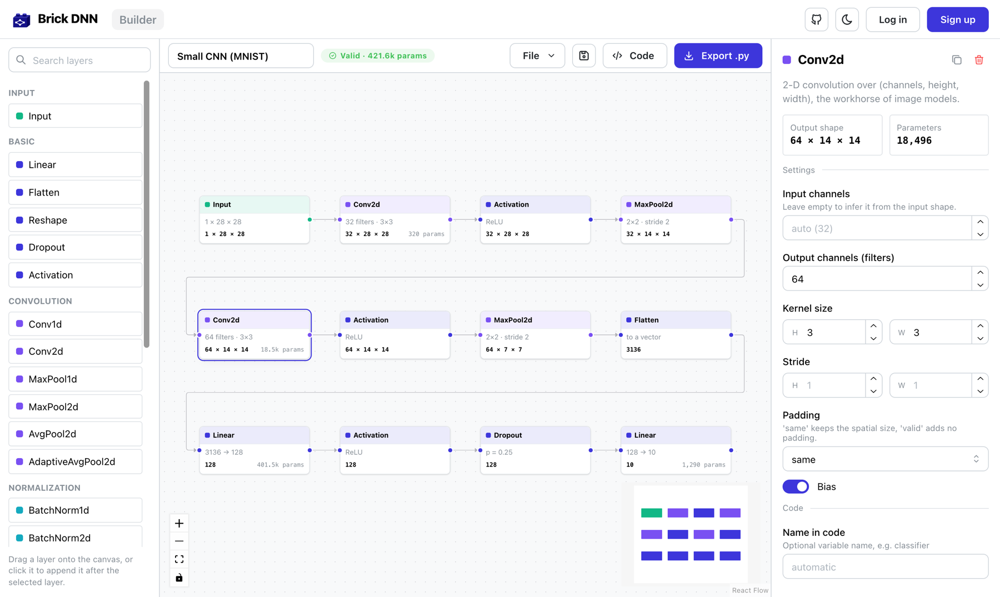
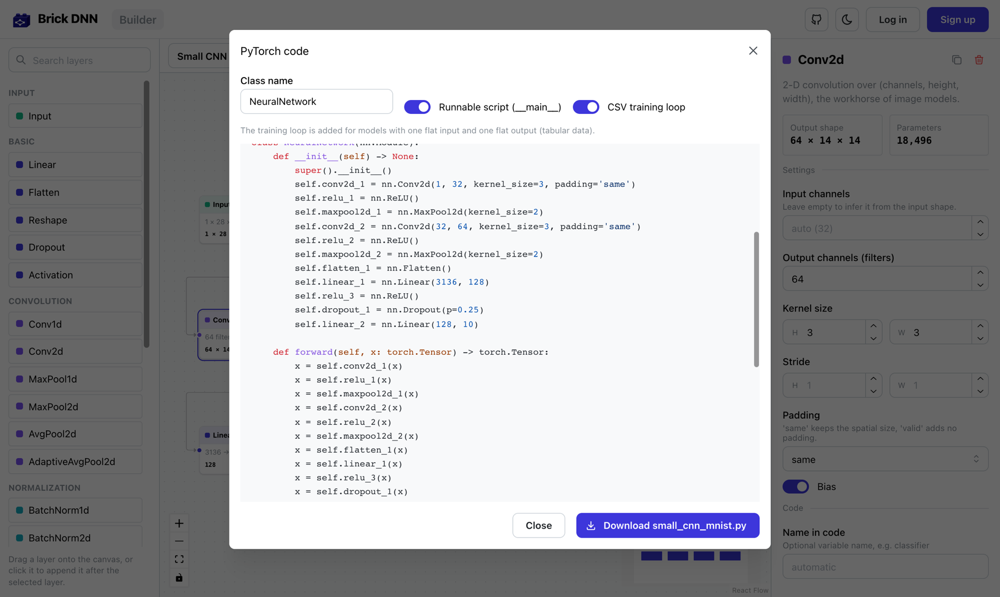
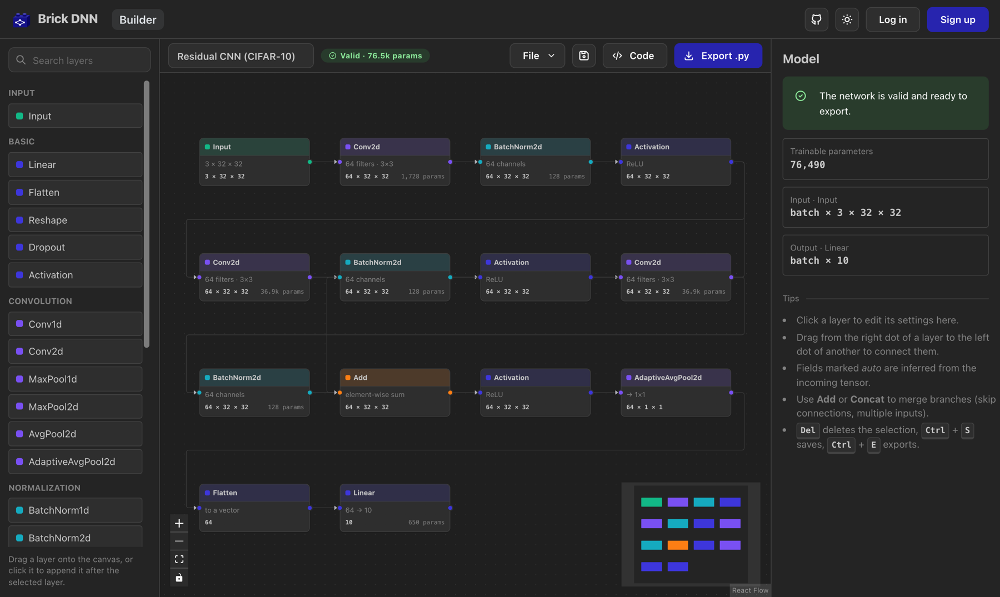
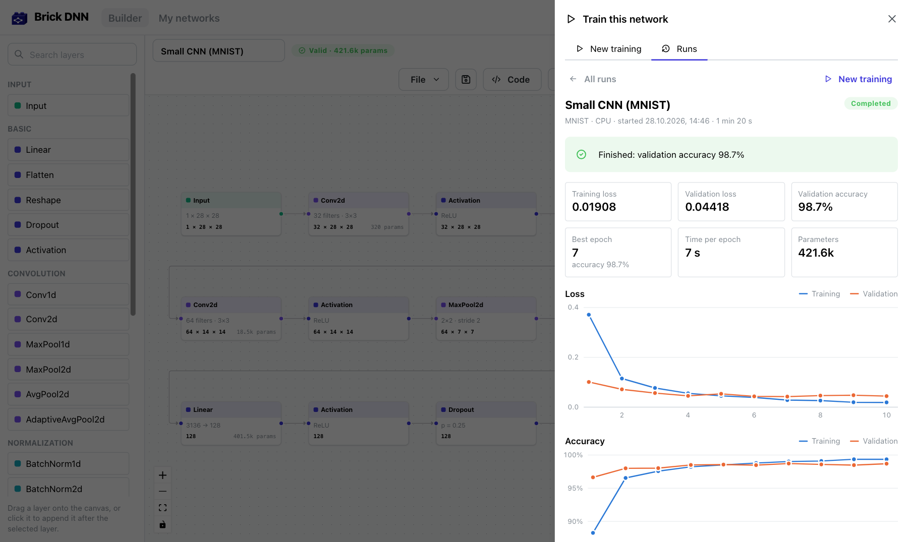
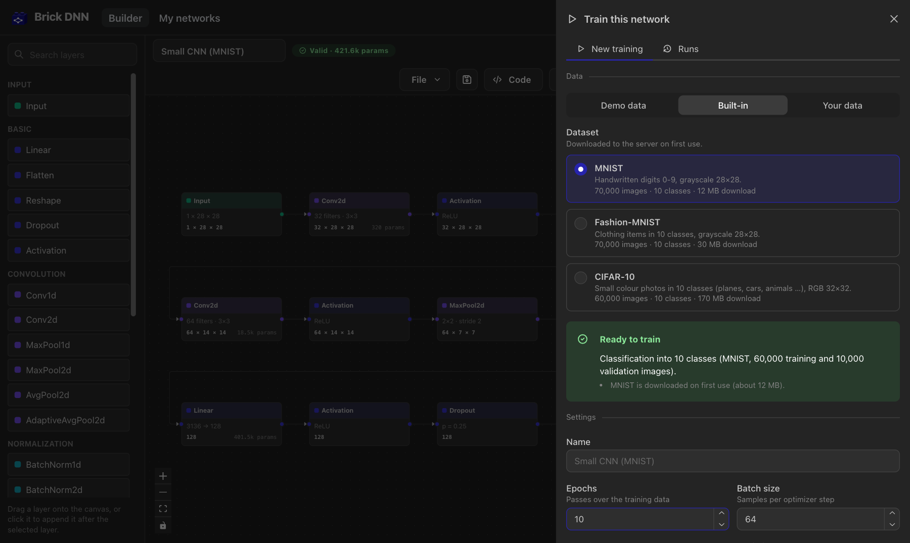

<p align="center">
  
</p>

<h1 align="center">Brick DNN</h1>

<p align="center">
  <b>Build neural networks from bricks. Train them locally. Export clean, runnable PyTorch code.</b>
</p>

<p align="center">
  <a href="https://brickdnn.com"><b>▶LIVE VERSION</b></a>
  &nbsp;·&nbsp;
  <a href="https://huggingface.co/spaces/alexKlg/brick-dnn"><b>▶ Try the online demo</b></a>
  &nbsp;·&nbsp;
  <a href="#quick-start">Run it locally</a>
</p>

<p align="center">
  <a href="https://github.com/alexanderKuehling/brick-dnn/actions/workflows/ci.yml"></a>
  <a href="LICENSE"></a>
  
  
  <a href="https://buymeacoffee.com/alexanderkzw"></a>
</p>



Sketching a network architecture is easy; getting every tensor shape right is not.
Brick DNN lets you snap layers together on a canvas, **shows the shape of every tensor while you
build**, points at mistakes before you run anything, **trains the network on your own machine**
with live loss and accuracy curves, and exports a self-contained PyTorch script that you can
read, run, train and modify.

It is meant for students learning how architectures fit together, teachers who want to
demonstrate them, and practitioners who want a correct starting point in seconds.

## Features

- **Drag-and-drop editor** for 24 layer types: MLPs, CNNs, RNN/LSTM/GRU and Transformers.
- **Live shape inference**: every layer shows its output shape and parameter count. Fields
  such as `in_features` or `in_channels` are filled in automatically, so you never compute a
  flatten size by hand again.
- **Instant validation** with clear messages (*"Kernel size 7 is larger than the padded input
  size 4"*, *"Model dimension 30 must be divisible by the number of attention heads (4)"*).
- **Real graphs, not just stacks**: skip connections (`Add`), multiple inputs and outputs and
  branch merging (`Concat`).
- **Local training from the editor**: press *Train*, pick demo data, MNIST, Fashion-MNIST,
  CIFAR-10, a CSV file, a folder of images or images with masks, and watch loss and accuracy
  live. Training runs
  in PyTorch on the backend machine (CUDA, Apple GPU or CPU), never in the browser. Brick DNN
  checks beforehand whether network and data fit and says what to change. Hold out a test set,
  stop early when the validation loss no longer improves (the weights of the best epoch are
  kept), let a **hyperparameter search** find a good learning rate, batch size or optimizer,
  and download the trained weights together with the matching script. With Docker, trainings
  wait in a **queue** and a separate worker container trains them, so the site stays
  responsive and nothing is refused because the server is busy. See
  [docs/training.md](docs/training.md).
- **Image segmentation**: train a U-Net (or any network that keeps the image size) on images
  with one mask each, a ZIP file with the folders `images` and `masks`, or on the built-in
  generated dataset *Shapes* without uploading anything. The run reports mean IoU, Dice and
  pixel accuracy per epoch and the IoU of every class, and shows what the network predicts
  for a few validation images next to their true masks. See
  [docs/training.md](docs/training.md#image-segmentation).
- **Data preparation and analysis** in the *Data* tab: import messy CSV files, Excel and
  OpenDocument workbooks (choose the sheet), JSON / JSON Lines, Parquet and Feather files, also
  zipped or gzipped, or straight from a link (Google Sheets, GitHub, Hugging Face …), join and
  append tables, fill missing values (median, KNN …), detect and clip outliers (IQR, z-score,
  quantiles), scale, transform, bin and encode columns, split dates, balance classes, and see
  every step's effect in charts: distributions, box plots, missing values, correlation
  heatmaps, scatter plots and target analysis. Values are learned from the training rows only,
  and the result becomes a training dataset with a fixed train/validation/test split, a
  cleaned CSV file or a standalone pandas script. See [docs/data-preparation.md](docs/data-preparation.md).
- **MCP server for AI assistants**: add Brick DNN as a connector in Claude (or another MCP
  client), sign in with OAuth, and let it build, check, save and train networks in your
  account, upload small CSV datasets, predict with trained networks and hand you their
  weights; you decide whether it may change things or only look. Personal API tokens work
  for clients without OAuth and for scripts against the REST API. See
  [docs/mcp.md](docs/mcp.md).
- **Classical models** next to the neural networks: **Gaussian process** regression and
  classification with kernels you compose from bricks (RBF, Matérn, rational quadratic,
  periodic, dot product, white noise and constant kernels, added and multiplied), and
  **support vector machines** (SVR, SVC). They train on CSV files and prepared datasets with
  scikit-learn (no PyTorch needed), report the fitted kernel and its log marginal likelihood
  or the support vectors, predict with uncertainty (Gaussian processes) or class
  probabilities, and export as a scikit-learn script. See
  [docs/training.md](docs/training.md#classical-models).
- **Readable PyTorch output**: an `nn.Module` with named layers, a sanity check with a random
  batch and, for tabular models, a ready-to-use **CSV training loop**.
- **Examples** to start from: MLP, CNN, residual block, U-Net (image segmentation), LSTM and
  Transformer text classifiers, tabular regression, multi-input model, Gaussian process
  regression, SVM classifier and a periodic Gaussian process.
- **Accounts and saved networks** (optional): building and exporting work without logging in.
  Networks can also be saved and opened as JSON files. Users download all their data or delete
  their account themselves; servers can show an imprint, privacy policy and terms of use and
  delete unused data automatically ([docs/privacy.md](docs/privacy.md)).
- **Standalone generator**: the `brickdnn` Python package has no dependencies and comes with a
  CLI, so you can generate models from JSON in scripts or CI.
- Dark mode, keyboard shortcuts, works on tablets and phones.

<table>
  <tr>
    <td></td>
    <td></td>
  </tr>
</table>

**Train the network right in the editor**: a small CNN reaches 98.7 % on MNIST after ten epochs
on a laptop CPU, with loss and accuracy shown live.

<table>
  <tr>
    <td></td>
    <td></td>
  </tr>
</table>

## Quick start

### With Docker (recommended)

```bash
git clone https://github.com/alexanderKuehling/brick-dnn.git
cd brick-dnn
docker compose up -d
```

Open <http://localhost:8080>. Data (accounts, saved networks, training runs) lives in the
`brickdnn-data` volume. To enable training of neural networks, build the image with PyTorch
(CPU, about 1 GB more): `BRICKDNN_INSTALL_TORCH=true docker compose up -d --build`. Classical
models (Gaussian processes, SVMs) train in the default image. To create an admin account for the Django admin at `/admin/`:

```bash
docker compose exec backend python manage.py createsuperuser
```

Trainings are queued in the database and trained by the `worker` service, one at a time by
default (`BRICKDNN_WORKER_SLOTS`); `docker compose logs worker` shows what it does, and
[docs/training.md](docs/training.md#the-training-queue) how the queue works.

On a public server (HTTPS with Caddy, automatic deploys from GitHub Actions after every
push to `main`, the web backend and the training worker with their own limits within three
quarters of the server): [deploy/server/README.md](deploy/server/README.md).

### For development

You need Python 3.10+ and Node.js 22.22.2+ (or 24.15+).

```bash
# 1. API on http://127.0.0.1:8000
cd backend
python -m venv .venv
source .venv/bin/activate              # Windows: .venv\Scripts\activate
pip install -r requirements-dev.txt
pip install torch torchvision          # optional: enables training (GPU is used if available)
python manage.py migrate
DJANGO_DEBUG=true python manage.py runserver

# 2. In a second terminal: UI on http://localhost:5173
cd frontend
npm install
npm run dev
```

The Vite dev server proxies `/api` to the backend, so no CORS setup is needed. If the API runs
elsewhere, start the UI with `BACKEND_URL=http://host:port npm run dev`.

A `Makefile` wraps these steps (`make install`, `make install-training`, `make backend`,
`make frontend`, `make test`). In development the API trains itself, one training at a time.
To try the training queue, start the API and, in another terminal, the worker
(`python manage.py training_worker`), both with `BRICKDNN_TRAINING_WORKER=true`.

### Online demo

The [online demo](https://huggingface.co/spaces/alexKlg/brick-dnn) needs no server: the
`brickdnn` code generator runs in the browser with [Pyodide](https://pyodide.org). Accounts
and training are switched off. `npm run build:demo` (in `frontend/`) builds it into
`frontend/dist-demo/`, which can be hosted as static files anywhere;
`npm run dev:demo` runs it locally. `deploy/huggingface/deploy.sh` builds it and uploads it
to the Hugging Face Space. On GitHub, the *Deploy demo* workflow does this after every
successful CI run on `main` (it needs the repository secret `HF_TOKEN`).

## How to use it

1. Drag an **Input** layer onto the canvas and set its shape **without the batch dimension**,
   e.g. `784` for flattened MNIST, `3, 32, 32` for CIFAR images, or `64` with data type
   `long` for 64 token ids.
2. **Click** a layer in the palette to append it after the selected layer (it is connected
   automatically), or **drag** it onto the canvas and connect it yourself by dragging from the
   right dot of one layer to the left dot of another.
3. Select a layer to edit its settings in the panel on the right. Fields marked *auto* are
   inferred from the incoming tensor.
4. Fix anything marked red, then press **Export .py** (or <kbd>Ctrl</kbd>+<kbd>E</kbd>).
5. Or press **Train**: choose the data and settings and train the network right away. When it is
   done, download the weights (`.pt`) and the script that loads them.

For a **classical model**, connect the Input straight to a model from the *Classical ·
scikit-learn* part of the palette (Gaussian process, SVR, SVC). Kernels flow along dashed
connections into a *Kernel sum*, a *Kernel product* or the kernel input of a Gaussian
process; select the Gaussian process or a kernel sum and click a kernel to plug it in. The
inspector shows the resulting kernel as scikit-learn code. Training fits the model once and
gives you the fitted model as a `.joblib` file.

The exported file runs as is:

```bash
python small_cnn_mnist.py                       # prints the model, runs a random batch
python tabular_model.py --csv data.csv --epochs 20   # tabular models: train on a CSV file
python tabular_model.py --predict new.csv             # … and predict new rows with model.pt
```

<details>
<summary>Example output (model part)</summary>

```python
class NeuralNetwork(nn.Module):
    def __init__(self) -> None:
        super().__init__()
        self.conv2d_1 = nn.Conv2d(1, 32, kernel_size=3, padding='same')
        self.relu_1 = nn.ReLU()
        self.maxpool2d_1 = nn.MaxPool2d(kernel_size=2)
        self.conv2d_2 = nn.Conv2d(32, 64, kernel_size=3, padding='same')
        self.relu_2 = nn.ReLU()
        self.maxpool2d_2 = nn.MaxPool2d(kernel_size=2)
        self.flatten_1 = nn.Flatten()
        self.linear_1 = nn.Linear(3136, 128)
        self.relu_3 = nn.ReLU()
        self.dropout_1 = nn.Dropout(p=0.25)
        self.linear_2 = nn.Linear(128, 10)

    def forward(self, x: torch.Tensor) -> torch.Tensor:
        x = self.conv2d_1(x)
        x = self.relu_1(x)
        x = self.maxpool2d_1(x)
        x = self.conv2d_2(x)
        x = self.relu_2(x)
        x = self.maxpool2d_2(x)
        x = self.flatten_1(x)
        x = self.linear_1(x)
        x = self.relu_3(x)
        x = self.dropout_1(x)
        x = self.linear_2(x)
        return x
```

For graphs with branches, every layer gets its own variable (`added_1 = batchnorm2d_3 + relu_1`).
</details>

## Available layers

| Category      | Layers                                                                                  |
| ------------- | --------------------------------------------------------------------------------------- |
| Input         | `Input` (any shape, `float` or `long` token ids)                                          |
| Basic         | `Linear`, `Flatten`, `Reshape`, `Dropout`, `Activation` (ReLU, LeakyReLU, GELU, ELU, SELU, SiLU, Mish, Sigmoid, Tanh, Softplus, Softmax, LogSoftmax) |
| Convolution   | `Conv1d`, `Conv2d`, `ConvTranspose2d`, `MaxPool1d`, `MaxPool2d`, `AvgPool2d`, `AdaptiveAvgPool2d` |
| Normalization | `BatchNorm1d`, `BatchNorm2d`, `LayerNorm`                                                |
| Sequence      | `Embedding`, `PositionalEmbedding`, `RNN`, `LSTM`, `GRU`, `TransformerEncoder`, `SequencePool` |
| Merge         | `Add` (residual connections), `Concat`                                                   |
| Kernels       | `RBF`, `Matern`, `RationalQuadratic`, `ExpSineSquared`, `DotProduct`, `WhiteKernel`, `ConstantKernel`, `KernelSum`, `KernelProduct` (for Gaussian processes) |
| Classical models | `GaussianProcessRegressor`, `GaussianProcessClassifier`, `SVR`, `SVC` (scikit-learn) |

Missing a layer? Adding one takes about 30 lines of Python, see
[docs/adding-a-layer.md](docs/adding-a-layer.md). The UI picks it up automatically.

## Use the generator without the UI

The code generator is a separate, dependency-free Python package:

```bash
pip install "git+https://github.com/alexanderKuehling/brick-dnn#subdirectory=backend"

brickdnn --example resnet_block -o model.py   # bundled examples
brickdnn my_network.json --check              # validate, print shapes and parameter counts
brickdnn my_network.json -o model.py --class-name MyNet

pip install "brickdnn[train] @ git+https://github.com/alexanderKuehling/brick-dnn#subdirectory=backend"
brickdnn train my_network.json --data mnist --epochs 5 --save weights.pt
brickdnn train my_network.json --data houses.csv --test-split 0.2 --tune --trials 20
brickdnn train --example gp_regression --data houses.csv   # classical: only needs "brickdnn[classic]"
```

```python
from brickdnn import analyze, generate_code

result = analyze(graph)          # shapes, parameter counts, errors, warnings
code = generate_code(graph)      # raises GraphValidationError for invalid graphs
```

The graph format is plain JSON (the editor's *File → Save as JSON file* produces it), see
[docs/graph-format.md](docs/graph-format.md).

## Architecture

```
frontend/  React + Mantine + React Flow (TypeScript)
   │  palette & forms are generated from GET /api/layers/
   │  every edit → POST /api/analyze/ (debounced) → shapes and errors on the canvas
   │  export     → POST /api/generate/
   │  training   → POST /api/training/runs/, then polls the run once per second
   │  live editing of shared networks → WebSocket /api/ws/projects/<id>/
   ▼
backend/   Django REST API: accounts (JWT), saved and shared networks, datasets, training runs
   │          queues training runs in the database; a worker (manage.py training_worker, its
   │          own container) starts one process per run; the API reads the progress from
   │          state.json (without the worker, e.g. in development, the API starts them itself)
   │          live editing: Django Channels (served by Daphne), Redis between the processes
   ├── brickdnn/            pure Python: layer catalogue, graph validation, shape inference,
   │                        code generation (no dependencies)
   ├── brickdnn/training/   PyTorch training engine (optional) and scikit-learn engine for
   │                        classical models, used by the runner and the CLI
   └── brickdnn/data/       data preparation with pandas: imports, steps, profiles, export
```

The layer catalogue in `backend/brickdnn/layers.py` is the single source of truth: the UI has
no hard-coded knowledge of layers or their parameters.

```
brick-dnn/
├── backend/
│   ├── brickdnn/            code generator (standalone package + CLI)
│   │   ├── training/        training engine, runner process, `brickdnn train`
│   │   └── data/            data preparation: import, steps, analysis, export
│   ├── brick_dnn_core/      Django app: API views, models, sharing, live editing, MCP, OAuth
│   ├── brick_dnn_site/      Django settings and URLs
│   └── tests/               pytest suite (runs generated models in PyTorch if installed)
├── frontend/
│   └── src/
│       ├── builder/         canvas, palette, inspector, code preview
│       ├── sharing/         share dialog, networks shared by link
│       ├── training/        training panel: data, settings, live progress, history
│       ├── data/            Data tab: pipeline editor, data table, analysis views
│       ├── api/             typed API client
│       ├── auth/            login state
│       ├── account/         account page: e-mail, password, data export, deletion
│       ├── legal/           imprint, privacy policy, terms of use (safe Markdown)
│       └── pages/           login, sign-up, saved networks
├── deploy/                  server setup (Docker Compose, Caddy), legal templates, demo
├── docs/                    graph format, REST API, training, data, database, privacy, scaling
└── docker-compose.yml
```

## Configuration

All settings are environment variables, or lines in a file `.env` in the repository root
(see [`.env.example`](.env.example)):

| Variable                       | Default                    | Meaning                                              |
| ------------------------------ | -------------------------- | ---------------------------------------------------- |
| `DJANGO_SECRET_KEY`            | generated and stored in the data dir | Secret for signing tokens                  |
| `DJANGO_DEBUG`                 | `false`                    | Never enable in production                           |
| `DJANGO_ALLOWED_HOSTS`         | `localhost,127.0.0.1,[::1]` | Host names the server answers to                    |
| `DJANGO_CSRF_TRUSTED_ORIGINS`  | –                          | Needed for the Django admin behind a proxy           |
| `CORS_ALLOWED_ORIGINS`         | `http://localhost:5173,…`  | Only if UI and API run on different origins          |
| `BRICKDNN_DATA_DIR`            | `backend/data` (`/data` in Docker) | Files (datasets, runs), SQLite database, secret key |
| `DATABASE_URL`                 | – (SQLite)                 | PostgreSQL, e.g. Supabase: [docs/database.md](docs/database.md) |
| `BRICKDNN_ALLOW_REGISTRATION`  | `true`                     | Set to `false` for a private instance                |
| `BRICKDNN_NUM_PROXIES`         | `0` (`1` in Docker)        | Reverse proxies in front of Django (for rate limits) |
| `BRICKDNN_PORT`                | `8080`                     | Port used by Docker Compose                          |
| `BRICKDNN_TRAINING`            | `true`                     | Set to `false` to disable training                   |
| `BRICKDNN_TRAINING_MAX_RUNS`   | `1`                        | Trainings running at the same time (all users) when the web server trains itself; with Docker Compose also the default of `BRICKDNN_WORKER_SLOTS` |
| `BRICKDNN_TRAINING_WORKER`     | `true` with Docker Compose, else `false` | Trainings wait in a queue in the database and the `worker` service trains them, plans with a higher priority first; `false`: the web server trains itself and refuses a start while it is busy ([docs/training.md](docs/training.md#the-training-queue)) |
| `BRICKDNN_WORKER_SLOTS`        | from the CPUs              | Trainings the worker runs at the same time           |
| `BRICKDNN_QUEUE_MAX_WAITING`   | `3` with plans, else unlimited | Trainings of one account that may wait in the queue |
| `BRICKDNN_MAX_UPLOAD_MB`       | `500`                      | Maximum size of an uploaded dataset                  |
| `BRICKDNN_DATA_MAX_UPLOAD_MB`  | `200`                      | Largest import in the Data tab (file, link or unpacked) |
| `BRICKDNN_DATA_URL_IMPORT`     | `true`                     | Set to `false` to switch imports from links off      |
| `BRICKDNN_DATA_URL_ALLOW_PRIVATE` | `false`                 | Allow links to private network addresses (trusted local installations only) |
| `BRICKDNN_INSTALL_TORCH`       | `false`                    | Docker build: include PyTorch (CPU) for training     |
| `BRICKDNN_GP_MAX_ROWS`         | `5000`                     | Training rows a Gaussian process regression is fitted on at most |
| `BRICKDNN_GPC_MAX_ROWS`        | `2000`                     | Training rows a Gaussian process classifier is fitted on at most |
| `BRICKDNN_SVM_MAX_ROWS`        | `50000`                    | Training rows an SVM is fitted on at most             |
| `BRICKDNN_SEGMENTATION_MEMORY_MB` | `900`                   | Memory a batch of a segmentation training may need; larger batches are refused ([docs/training.md](docs/training.md#settings-memory-and-time)) |
| `BRICKDNN_PUBLIC_URL`          | from each request          | Public address, e.g. `https://brickdnn.com` (OAuth issuer) |
| `BRICKDNN_LEGAL_DIR`           | `legal/` in the data dir   | Folder with `imprint.md`, `privacy.md`, `terms.md` (shown at `/imprint` …); several separated by `:`, the first with a page wins |
| `BRICKDNN_DELETE_UNUSED_UPLOADS_DAYS` | `0` (off)           | Delete data sources, datasets and finished runs unused for this many days |
| `BRICKDNN_DELETE_INACTIVE_ACCOUNTS_DAYS` | `0` (off)        | Delete accounts unused for this many days, with everything they own |
| `BRICKDNN_EXPORT_MAX_FILES_MB` | `200`                      | Uploaded files included in a user's data export      |
| `BRICKDNN_AGENT_LOG_DAYS`      | `90`                       | Days the activity log of AI agents is kept (`0`: no log) |
| `BRICKDNN_PLANS`               | unset (no limits)          | Plans with their limits per account as JSON: compute per month, storage, compute per training, trainings at a time ([docs/training.md](docs/training.md#plans-and-limits)) |
| `BRICKDNN_DEFAULT_PLAN`        | the first plan             | The plan of accounts without one (`manage.py set_plan` changes it) |
| `BRICKDNN_BUDGET_CPU_MINUTES_PER_MONTH` / `_PER_RUN` | `0` (unlimited) | Without plans: compute per account and month / per training |
| `BRICKDNN_BUDGET_STORAGE_MB`   | `0` (unlimited)            | Without plans: storage per account                   |
| `BRICKDNN_STAFF_UNLIMITED`     | `true`                     | Staff and superusers have no limits                  |
| `BRICKDNN_ADMIN_USERS`         | unset                      | Usernames of accounts that become administrators when the backend starts; nobody can register these names |
| `BRICKDNN_PRICE_PER_CPU_HOUR` / `_PER_GB_MONTH` / `BRICKDNN_PRICE_CURRENCY` | unset / `EUR` | Show usage in money |
| `BRICKDNN_PADDLE_ENV`          | – (paid plans off)         | `sandbox` or `live`: sell the plans with Paddle, see [docs/billing.md](docs/billing.md) |
| `BRICKDNN_PADDLE_CLIENT_TOKEN` | –                          | Paddle's client-side token for the checkout (public) |
| `BRICKDNN_PADDLE_PRICES`       | –                          | The Paddle price of each paid plan: `starter=pri_…,plus=pri_…` |
| `BRICKDNN_PADDLE_OVERAGE_PRODUCT` | –                       | Paddle product that compute beyond the allowance is billed as |
| `BRICKDNN_PADDLE_API_KEY`      | –                          | Paddle API key (secret; only in `.env`)              |
| `BRICKDNN_PADDLE_WEBHOOK_SECRET` | –                        | Secret of Paddle's notification destination (secret; only in `.env`) |
| `BRICKDNN_PADDLE_GRACE_DAYS`   | `7`                        | Days an account keeps its plan after a failed payment |
| `VITE_API_URL`                 | same origin                | Build-time API URL if the UI is hosted separately    |

The REST API is documented in [docs/api.md](docs/api.md), the MCP server and API tokens in
[docs/mcp.md](docs/mcp.md), the database setup (SQLite,
PostgreSQL, Supabase) in [docs/database.md](docs/database.md). Running a server for other
people: [docs/privacy.md](docs/privacy.md) explains what is stored and for how long, the
legal pages (imprint, privacy policy, terms of use; templates in
[deploy/legal/](deploy/legal/README.md)), the account page where users export their data or
delete their account, and the optional automatic deletion of old data. Selling plans as
subscriptions with Paddle (off unless configured): [docs/billing.md](docs/billing.md). The
training queue and its worker: [docs/training.md](docs/training.md#the-training-queue); what
comes after one server: [docs/scaling.md](docs/scaling.md).

## Tests

```bash
cd backend && pytest          # 180+ tests; install torch to also execute the generated models:
                              # pip install torch --index-url https://download.pytorch.org/whl/cpu
cd frontend && npm test       # typecheck, prettier, eslint, stylelint, vitest
```

The backend suite builds every example and every layer type, runs the generated code in
PyTorch and checks that output shapes and parameter counts match the analysis exactly. It also
trains the generated CSV scripts end to end and runs the training engine on every example
(demo data, CSV files, image folders, images with masks, built-in datasets with faked
downloads). CI runs everything on Python 3.12 and 3.13 and builds
the Docker images.

## Roadmap

Ideas for future versions, contributions welcome:

- More layers: `GroupNorm`, `MultiheadAttention`, `Upsample`
- Grouping layers into reusable blocks
- Undo/redo
- Import of existing PyTorch models

## Why I built this

Hi everyone,

My name is Alexander Kühling and I am an MSc Computer Science student at ETHZ. I first became interested in data science in 2018, before the LLM, when I started training simple neural networks. I have always enjoyed experimenting with different structures and approaches, but it would take some time to set everything up and debug before I could test new approaches and networks. That's why I originally started this project.

However, due to other commitments (school, university, other projects, etc.), I never had the time to finish it. However, as coding agents have improved, I have had the opportunity to complete the project in a reasonable amount of time. I'm now glad to be able to share the working code with you.

If you have any feedback or would like to request additional features, you can either email me at alexander.kuehling@gmx.net or create a GH issue. I hope I can help you save time or get started on a deep learning project you've always wanted to do, but could never find the time to write the code for.

Have fun!

## Contributing

Bug reports, layer requests and pull requests are very welcome.
Please read [CONTRIBUTING.md](CONTRIBUTING.md) first.

## Support

Brick DNN is free and open source. If it helps you, you can
[buy me a coffee](https://buymeacoffee.com/alexanderkzw) ☕ — thank you!

## History

Brick DNN started as two separate repositories, a Django API (`brick_dnn_api`) and a React
app (`brick_dnn_app`). Version 1.0 merges both into this repository and completes the project:
graph-based code generation, shape inference, more layer types, tests, Docker and documentation.

## License

[Apache License 2.0](LICENSE) © Alexander Kühling
