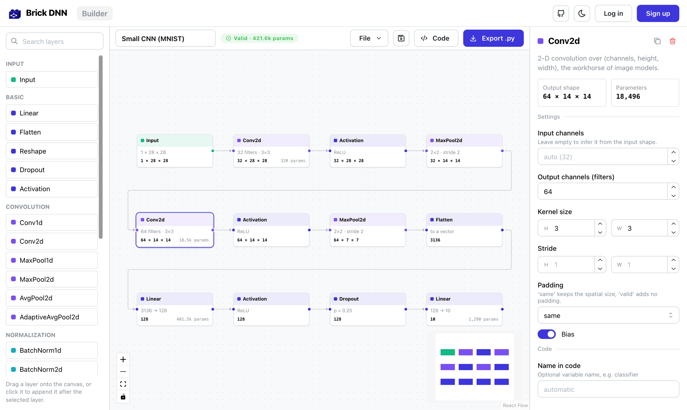
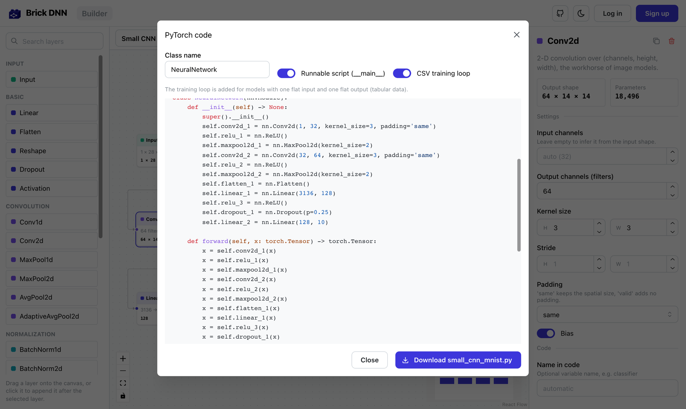
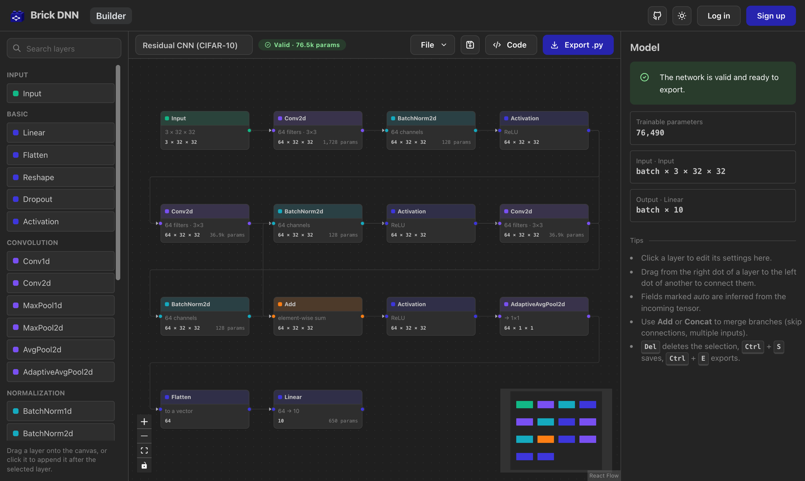
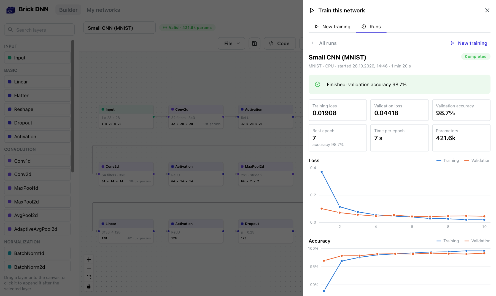
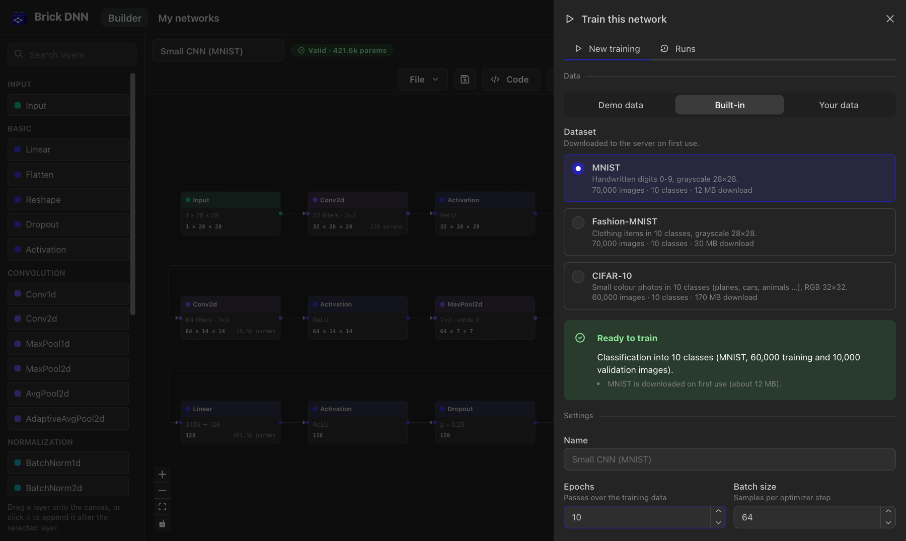

<h2> Human written motivation summary</h2>
Hi everyone,
My name is Alexander Kühling and I am an MSc Computer Science student at ETHZ. I first became interested in data science in 2018, before the LLM, when I started training simple neural networks. I have always enjoyed experimenting with different structures and approaches, but it would take some time to set everything up and debug before I could test new approaches and networks. That's why I originally started this project. However, due to other commitments (school, university, other projects, etc.), I never had the time to finish it. However, as coding agents have improved, I have had the opportunity to complete the project in a reasonable amount of time. I'm now glad to be able to share the working code with you. If you have any feedback or would like to request additional features, you can either email me at alexander.kuehling@gmx.net or create a GH issue. I hope I can help you save time or get started on a deep learning project you've always wanted to do, but could never find the time to write the code for. 
Have fun!
<h2> AI written description</h2>

<p align="center">
  
</p>

<h1 align="center">Brick DNN</h1>

<p align="center">
  <b>Build neural networks from bricks. Train them locally. Export clean, runnable PyTorch code.</b>
</p>

<p align="center">
  <a href="https://github.com/alexanderKuehling/brick-dnn/actions/workflows/ci.yml"></a>
  <a href="LICENSE"></a>
  
  
</p>



Sketching a network architecture is easy; getting every tensor shape right is not.
Brick DNN lets you snap layers together on a canvas, **shows the shape of every tensor while you
build**, points at mistakes before you run anything, **trains the network on your own machine**
with live loss and accuracy curves, and exports a self-contained PyTorch script that you can
read, run, train and modify.

It is meant for students learning how architectures fit together, teachers who want to
demonstrate them, and practitioners who want a correct starting point in seconds.

## Features

- **Drag-and-drop editor** for 24 layer types: MLPs, CNNs, RNN/LSTM/GRU and Transformers.
- **Live shape inference**: every layer shows its output shape and parameter count. Fields
  such as `in_features` or `in_channels` are filled in automatically, so you never compute a
  flatten size by hand again.
- **Instant validation** with clear messages (*"Kernel size 7 is larger than the padded input
  size 4"*, *"Model dimension 30 must be divisible by the number of attention heads (4)"*).
- **Real graphs, not just stacks**: skip connections (`Add`), multiple inputs and outputs and
  branch merging (`Concat`).
- **Local training from the editor**: press *Train*, pick demo data, MNIST, Fashion-MNIST,
  CIFAR-10, a CSV file or a folder of images, and watch loss and accuracy live. Training runs
  in PyTorch on the backend machine (CUDA, Apple GPU or CPU), never in the browser. Brick DNN
  checks beforehand whether network and data fit and says what to change. Download the trained
  weights together with the matching script. See [docs/training.md](docs/training.md).
- **Readable PyTorch output**: an `nn.Module` with named layers, a sanity check with a random
  batch and, for tabular models, a ready-to-use **CSV training loop**.
- **Examples** to start from: MLP, CNN, residual block, LSTM and Transformer text classifiers,
  tabular regression, multi-input model.
- **Accounts and saved networks** (optional): building and exporting work without logging in.
  Networks can also be saved and opened as JSON files.
- **Standalone generator**: the `brickdnn` Python package has no dependencies and comes with a
  CLI, so you can generate models from JSON in scripts or CI.
- Dark mode, keyboard shortcuts, works on tablets and phones.

<table>
  <tr>
    <td></td>
    <td></td>
  </tr>
</table>

**Train the network right in the editor**: a small CNN reaches 98.7 % on MNIST after ten epochs
on a laptop CPU, with loss and accuracy shown live.

<table>
  <tr>
    <td></td>
    <td></td>
  </tr>
</table>

## Quick start

### With Docker (recommended)

```bash
git clone https://github.com/alexanderKuehling/brick-dnn.git
cd brick-dnn
docker compose up -d
```

Open <http://localhost:8080>. Data (accounts, saved networks, training runs) lives in the
`brickdnn-data` volume. To enable training, build the image with PyTorch (CPU, about 1 GB more):
`BRICKDNN_INSTALL_TORCH=true docker compose up -d --build`. To create an admin account for the Django admin at `/admin/`:

```bash
docker compose exec backend python manage.py createsuperuser
```

### For development

You need Python 3.10+ and Node.js 20+.

```bash
# 1. API on http://127.0.0.1:8000
cd backend
python -m venv .venv
source .venv/bin/activate              # Windows: .venv\Scripts\activate
pip install -r requirements-dev.txt
pip install torch torchvision          # optional: enables training (GPU is used if available)
python manage.py migrate
DJANGO_DEBUG=true python manage.py runserver

# 2. In a second terminal: UI on http://localhost:5173
cd frontend
npm install
npm run dev
```

The Vite dev server proxies `/api` to the backend, so no CORS setup is needed. If the API runs
elsewhere, start the UI with `BACKEND_URL=http://host:port npm run dev`.

A `Makefile` wraps these steps (`make install`, `make install-training`, `make backend`,
`make frontend`, `make test`).

## How to use it

1. Drag an **Input** layer onto the canvas and set its shape **without the batch dimension**,
   e.g. `784` for flattened MNIST, `3, 32, 32` for CIFAR images, or `64` with data type
   `long` for 64 token ids.
2. **Click** a layer in the palette to append it after the selected layer (it is connected
   automatically), or **drag** it onto the canvas and connect it yourself by dragging from the
   right dot of one layer to the left dot of another.
3. Select a layer to edit its settings in the panel on the right. Fields marked *auto* are
   inferred from the incoming tensor.
4. Fix anything marked red, then press **Export .py** (or <kbd>Ctrl</kbd>+<kbd>E</kbd>).
5. Or press **Train**: choose the data and settings and train the network right away. When it is
   done, download the weights (`.pt`) and the script that loads them.

The exported file runs as is:

```bash
python small_cnn_mnist.py                       # prints the model, runs a random batch
python tabular_model.py --csv data.csv --epochs 20   # tabular models: train on a CSV file
```

<details>
<summary>Example output (model part)</summary>

```python
class NeuralNetwork(nn.Module):
    def __init__(self) -> None:
        super().__init__()
        self.conv2d_1 = nn.Conv2d(1, 32, kernel_size=3, padding='same')
        self.relu_1 = nn.ReLU()
        self.maxpool2d_1 = nn.MaxPool2d(kernel_size=2)
        self.conv2d_2 = nn.Conv2d(32, 64, kernel_size=3, padding='same')
        self.relu_2 = nn.ReLU()
        self.maxpool2d_2 = nn.MaxPool2d(kernel_size=2)
        self.flatten_1 = nn.Flatten()
        self.linear_1 = nn.Linear(3136, 128)
        self.relu_3 = nn.ReLU()
        self.dropout_1 = nn.Dropout(p=0.25)
        self.linear_2 = nn.Linear(128, 10)

    def forward(self, x: torch.Tensor) -> torch.Tensor:
        x = self.conv2d_1(x)
        x = self.relu_1(x)
        x = self.maxpool2d_1(x)
        x = self.conv2d_2(x)
        x = self.relu_2(x)
        x = self.maxpool2d_2(x)
        x = self.flatten_1(x)
        x = self.linear_1(x)
        x = self.relu_3(x)
        x = self.dropout_1(x)
        x = self.linear_2(x)
        return x
```

For graphs with branches, every layer gets its own variable (`added_1 = batchnorm2d_3 + relu_1`).
</details>

## Available layers

| Category      | Layers                                                                                  |
| ------------- | --------------------------------------------------------------------------------------- |
| Input         | `Input` (any shape, `float` or `long` token ids)                                          |
| Basic         | `Linear`, `Flatten`, `Reshape`, `Dropout`, `Activation` (ReLU, LeakyReLU, GELU, ELU, SELU, SiLU, Mish, Sigmoid, Tanh, Softplus, Softmax, LogSoftmax) |
| Convolution   | `Conv1d`, `Conv2d`, `MaxPool1d`, `MaxPool2d`, `AvgPool2d`, `AdaptiveAvgPool2d`             |
| Normalization | `BatchNorm1d`, `BatchNorm2d`, `LayerNorm`                                                |
| Sequence      | `Embedding`, `PositionalEmbedding`, `RNN`, `LSTM`, `GRU`, `TransformerEncoder`, `SequencePool` |
| Merge         | `Add` (residual connections), `Concat`                                                   |

Missing a layer? Adding one takes about 30 lines of Python, see
[docs/adding-a-layer.md](docs/adding-a-layer.md). The UI picks it up automatically.

## Use the generator without the UI

The code generator is a separate, dependency-free Python package:

```bash
pip install "git+https://github.com/alexanderKuehling/brick-dnn#subdirectory=backend"

brickdnn --example resnet_block -o model.py   # bundled examples
brickdnn my_network.json --check              # validate, print shapes and parameter counts
brickdnn my_network.json -o model.py --class-name MyNet

pip install "brickdnn[train] @ git+https://github.com/alexanderKuehling/brick-dnn#subdirectory=backend"
brickdnn train my_network.json --data mnist --epochs 5 --save weights.pt
```

```python
from brickdnn import analyze, generate_code

result = analyze(graph)          # shapes, parameter counts, errors, warnings
code = generate_code(graph)      # raises GraphValidationError for invalid graphs
```

The graph format is plain JSON (the editor's *File → Save as JSON file* produces it), see
[docs/graph-format.md](docs/graph-format.md).

## Architecture

```
frontend/  React + Mantine + React Flow (TypeScript)
   │  palette & forms are generated from GET /api/layers/
   │  every edit → POST /api/analyze/ (debounced) → shapes and errors on the canvas
   │  export     → POST /api/generate/
   │  training   → POST /api/training/runs/, then polls the run once per second
   ▼
backend/   Django REST API: accounts (JWT), saved networks, datasets, training runs
   │          starts one process per training run, reads its progress from state.json
   ├── brickdnn/            pure Python: layer catalogue, graph validation, shape inference,
   │                        code generation (no dependencies)
   └── brickdnn/training/   PyTorch training engine (optional), used by the runner and the CLI
```

The layer catalogue in `backend/brickdnn/layers.py` is the single source of truth: the UI has
no hard-coded knowledge of layers or their parameters.

```
brick-dnn/
├── backend/
│   ├── brickdnn/            code generator (standalone package + CLI)
│   │   └── training/        training engine, runner process, `brickdnn train`
│   ├── brick_dnn_core/      Django app: API views, Project model
│   ├── brick_dnn_site/      Django settings and URLs
│   └── tests/               pytest suite (runs generated models in PyTorch if installed)
├── frontend/
│   └── src/
│       ├── builder/         canvas, palette, inspector, code preview
│       ├── training/        training panel: data, settings, live progress, history
│       ├── api/             typed API client
│       ├── auth/            login state
│       └── pages/           login, sign-up, saved networks
├── docs/                    graph format, REST API, training, contributor guide
└── docker-compose.yml
```

## Configuration

All settings are environment variables (see [`.env.example`](.env.example)):

| Variable                       | Default                    | Meaning                                              |
| ------------------------------ | -------------------------- | ---------------------------------------------------- |
| `DJANGO_SECRET_KEY`            | generated and stored in the data dir | Secret for signing tokens                  |
| `DJANGO_DEBUG`                 | `false`                    | Never enable in production                           |
| `DJANGO_ALLOWED_HOSTS`         | `localhost,127.0.0.1,[::1]` | Host names the server answers to                    |
| `DJANGO_CSRF_TRUSTED_ORIGINS`  | –                          | Needed for the Django admin behind a proxy           |
| `CORS_ALLOWED_ORIGINS`         | `http://localhost:5173,…`  | Only if UI and API run on different origins          |
| `BRICKDNN_DATA_DIR`            | `backend/data` (`/data` in Docker) | SQLite database and generated secret key     |
| `BRICKDNN_ALLOW_REGISTRATION`  | `true`                     | Set to `false` for a private instance                |
| `BRICKDNN_NUM_PROXIES`         | `0` (`1` in Docker)        | Reverse proxies in front of Django (for rate limits) |
| `BRICKDNN_PORT`                | `8080`                     | Port used by Docker Compose                          |
| `BRICKDNN_TRAINING`            | `true`                     | Set to `false` to disable training                   |
| `BRICKDNN_TRAINING_MAX_RUNS`   | `1`                        | Trainings running at the same time (all users)       |
| `BRICKDNN_MAX_UPLOAD_MB`       | `500`                      | Maximum size of an uploaded dataset                  |
| `BRICKDNN_INSTALL_TORCH`       | `false`                    | Docker build: include PyTorch (CPU) for training     |
| `VITE_API_URL`                 | same origin                | Build-time API URL if the UI is hosted separately    |

The REST API is documented in [docs/api.md](docs/api.md).

## Tests

```bash
cd backend && pytest          # 180+ tests; install torch to also execute the generated models:
                              # pip install torch --index-url https://download.pytorch.org/whl/cpu
cd frontend && npm test       # typecheck, prettier, eslint, stylelint, vitest
```

The backend suite builds every example and every layer type, runs the generated code in
PyTorch and checks that output shapes and parameter counts match the analysis exactly. It also
trains the generated CSV scripts end to end and runs the training engine on every example
(demo data, CSV files, image folders, built-in datasets with faked downloads). CI runs everything on Python 3.10–3.13 and builds
the Docker images.

## Roadmap

Ideas for future versions, contributions welcome:

- More layers: `GroupNorm`, `ConvTranspose2d`, `MultiheadAttention`, `Upsample`
- Grouping layers into reusable blocks
- Undo/redo
- Import of existing PyTorch models
- Running the generator in the browser (Pyodide) for a serverless demo

## Contributing

Bug reports, layer requests and pull requests are very welcome.
Please read [CONTRIBUTING.md](CONTRIBUTING.md) first.

## History

Brick DNN started as two separate repositories, a Django API (`brick_dnn_api`) and a React
app (`brick_dnn_app`). Version 1.0 merges both into this repository and completes the project:
graph-based code generation, shape inference, more layer types, tests, Docker and documentation.

## License

[MIT](LICENSE) © Alexander Kühling
