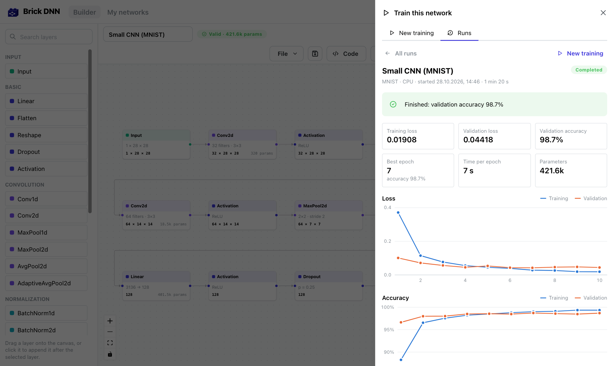
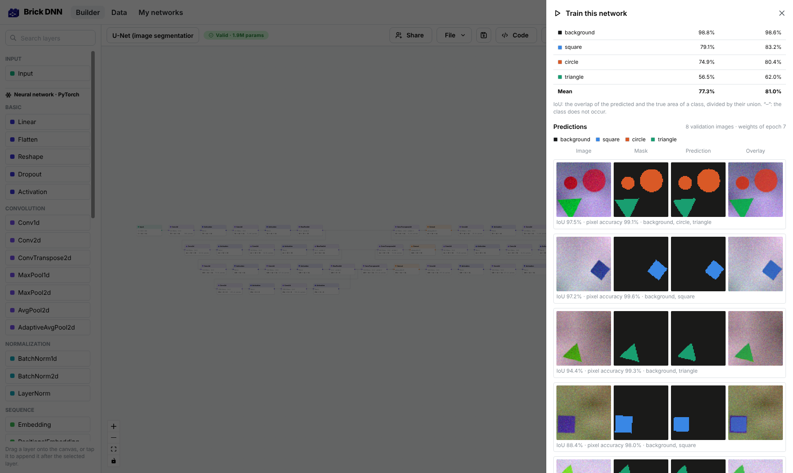

# Training

Brick DNN can train the network you built **on the machine that runs the backend**, with
PyTorch. You start and watch the training in the editor; nothing is computed in the browser.
The same engine is available on the command line as `brickdnn train`. Networks that give
every pixel a class are covered in [Image segmentation](#image-segmentation). Classical models
(Gaussian processes and support vector machines) are fitted with scikit-learn instead, see
[Classical models](#classical-models).



## Setup

Training needs PyTorch and torchvision in the backend environment. Everything else in Brick DNN
works without them. Classical models only need scikit-learn, which is part of the backend's
requirements (and of the default Docker image), so they train even without PyTorch. Pillow,
which reads the masks of an uploaded [segmentation dataset](#image-segmentation), is part of
the requirements too.

```bash
# local development setup (see the README)
make install-training            # = backend/.venv/bin/pip install torch torchvision

# Docker: PyTorch (CPU) is not in the default image because it adds about 1 GB
BRICKDNN_INSTALL_TORCH=true docker compose up -d --build     # or: make docker-training
```

Restart the backend afterwards. The **Train** button in the editor then shows which devices
are available. Training uses an NVIDIA GPU (CUDA) or the GPU of an Apple Silicon Mac (MPS)
automatically when PyTorch supports one, otherwise the CPU. On Intel Macs the CPU is the
default: PyTorch's GPU support there is no faster and has been seen computing wrong results.
Before training on an Apple GPU, Brick DNN compares one batch with the CPU and switches to the
CPU if the results differ. Docker containers only get the CPU build, so for GPU training run
the backend outside Docker.

Training requires an account (like saving networks), because runs and uploaded datasets are
stored per user.

## Training in the editor

1. Build a network, or load one of the examples. It must be free of errors.
2. Press **Train** in the toolbar.
3. Choose the data (see below). Brick DNN immediately checks whether the network fits the data
   and explains what to change, for example *"The network outputs 5 values, but MNIST has 10
   classes. The last layer should output 10 values."* The Input layer follows the data: see
   [Adapting the network to the data](#adapting-the-network-to-the-data).
4. Adjust the settings (epochs, batch size, learning rate, optimizer, device) and press
   **Start training**. Optionally hold out a [test set](#validation-and-test-data), let
   [early stopping](#early-stopping-and-the-kept-weights) end the training when the network
   stops improving, or let a [hyperparameter search](#hyperparameter-search) choose some of
   the settings.
5. Watch loss and accuracy (for a regression: RMSE and R², for a segmentation: mean IoU,
   Dice and pixel accuracy) per epoch. You can close the panel; the training continues and
   the button in the toolbar shows its progress.
6. When the run is finished (or stopped), download the **weights** (`.pt`) and the matching
   **script** (`.py`).

The panel can be widened to the full width of the window with the button next to its close
button (and back); the browser remembers the choice. At full width the run view shows its
results on the left and the [explanations](explain.md) on the right. On phones the panel
always fills the screen.

All runs are kept in the **History** tab together with the exact network that was trained.
With Docker Compose, trainings wait in a [queue](#the-training-queue) and a worker trains
them one after the other; without it, the web server trains itself, one training at a time
by default (`BRICKDNN_TRAINING_MAX_RUNS`), and refuses a start while it is busy.

### Data

| Source | What it is | Network requirements |
| ------ | ---------- | -------------------- |
| **Demo data** | Random inputs plus a hidden rule that the network can learn. Shows whether a network trains at all. Works with every network, including text models and several inputs/outputs. | none |
| **MNIST**, **Fashion-MNIST** | 70,000 grayscale 28×28 images of digits / clothing, 10 classes. Downloaded on first use (12 / 30 MB). | Input `1, 28, 28`, `28, 28` or `784`; 10 outputs |
| **CIFAR-10** | 60,000 colour 32×32 photos, 10 classes. Downloaded on first use (170 MB). | Input `3, 32, 32` or `3072`; 10 outputs |
| **CSV file** | Upload a `.csv`: every column but the last is a numeric feature, the last column is the target. | Input = number of feature columns; 1 output (regression) or one output per class |
| **Image folder** | Upload a `.zip` with one folder per class, e.g. `cats/001.jpg`, `dogs/001.jpg`. | Input `1, H, W` or `3, H, W` (or flat: `3·S·S` or `S·S` values for S×S images); one output per class |
| **Shapes** | 500 generated 64×64 images of squares, circles and triangles with a class for every pixel (4 classes). Nothing is downloaded. See [Image segmentation](#image-segmentation). | Input `3, H, W` or `1, H, W`; output `4, H, W` |
| **Images with masks** | Upload a `.zip` with the folders `images` and `masks` (same file names), see [Image segmentation](#image-segmentation). | Input `1, H, W` or `3, H, W`; output one channel per class at the same height and width |

Details:

- **Images** are converted to the number of channels of the Input layer (grayscale or RGB) and
  resized to its height and width, so a CNN built for 32×32 also trains on MNIST. Pixel values
  are normalised per channel. A flat Input (e.g. followed by a Linear layer) takes the images
  flattened: `784` = 28×28 grayscale for MNIST, `3072` = 3×32×32 for CIFAR-10; for an image
  folder, `12288` = 3×64×64 RGB or `784` = 28×28 grayscale (square images of at least 8×8).
- How much data is held out for validation and testing is explained
  [below](#validation-and-test-data).
- **CSV files** may use `,`, `;` or tabs as separators and decimal commas (`1,5`). A header
  line is detected automatically. Features are standardised (mean 0, standard deviation 1).
  - *Classification*: the target is a class index `0 … K-1` or a text label (`setosa`,
    `virginica` …; mapped to indices in alphabetical order). The network needs K outputs.
  - *Regression*: the target is a number and the network has a single output. Besides the
    loss, the validation and test results are reported as RMSE in the units of the target and
    as R², see [Regression metrics](#regression-metrics).
- Text models (Input data type `long`) and networks with several inputs or outputs can only be
  trained on demo data so far.
- Uploads are limited to `BRICKDNN_MAX_UPLOAD_MB` (default 500 MB).

### Adapting the network to the data

The Input layer follows the dataset chosen for training. When the network does not fit, the
check also says how to fix it, and Brick DNN applies the fix for you:

- **Automatically**, once each time you choose a dataset (in the training panel, after an
  upload, or with **Train with this data** in the [Data tab](data-preparation.md)), if only the
  Input layer's shape (and data type) and the number of outputs of the last layer have to
  change. A notification says what changed, e.g. *"Input set to 4 features, last layer to 3
  outputs from “iris”"*, with **Undo**. On an empty canvas, choosing a dataset starts a small
  network for it (Input → Linear → ReLU → Linear; images are flattened first).
- **With one click** otherwise: **Adapt network to “…”** below the check result lists the
  changes, for example also when the network fits but has more outputs than there are classes.
  The Inspector of an Input layer shows *Matches “…”* or offers **Set from dataset**.

Only two layers are ever changed: the Input layer (`shape`, data type `float`) and the last
Linear layer (also behind activations or dropout; `out_features` = one per class for
classification, 1 for a regression); for a segmentation dataset instead the last `Conv2d` or
`ConvTranspose2d` layer (`out_channels` = one per class). A shape that works is kept (a CNN for 1×28×28 also trains
on CIFAR-10); otherwise the Input gets the shape of the data, flat when it is flat now (e.g.
`784` for MNIST before a Linear layer). Nothing is suggested when other layers would have to
change too, e.g. a CNN on a CSV file or a Linear layer with a fixed number of input features;
the check then explains what to do. Opening a network does not change it, even if a dataset is
remembered from before, and people who can only view a network never get any of this. In a
shared network, the changes reach the others like any edit. For a
[classical model](#classical-models) only the Input's shape is ever changed: its output
follows the data.

### Settings

| Setting | Default | Notes |
| ------- | ------- | ----- |
| Epochs | 10 | Passes over the training data |
| Batch size | 64 | Lower it if you run out of memory |
| Learning rate | 0.001 | If the loss becomes NaN, lower it |
| Optimizer | Adam | Adam, AdamW or SGD (momentum 0.9) |
| Weight decay | 0 | L2 regularisation |
| Validation split | 0.2 | Share of the data used for validation (built-in datasets: of the training images); 0 to 0.5, 0 = no validation data (see [Training without validation data](#training-without-validation-data)) |
| Test split | 0 (none) | Share held out as test set; not used for built-in datasets, which always test on their official test images |
| Device | Automatic | CUDA → Apple GPU (Apple Silicon) → CPU |
| Max. samples | all | Train on a subset for quick experiments; validation shrinks in proportion |
| Seed | random | Fix it for reproducible runs |
| Early stopping (patience) | off | Stop when the validation loss has not improved for this many epochs (needs validation data) |
| Keep the best weights | on | Test and save the weights of the epoch with the lowest validation loss, not those of the last epoch (without validation data the last epoch is always kept) |
| Loss | Cross-entropy | Segmentation only: *Cross-entropy + Dice* for classes with few pixels |

The loss is chosen from the task: cross-entropy for classification (the network should end
with raw scores, not Softmax), mean squared error for regression, the cross-entropy of every
pixel for a [segmentation](#image-segmentation).

### Validation and test data

The data is split randomly (with the seed) into up to three parts:

- **Training data** is what the network learns from.
- **Validation data** is measured after every epoch (the curves). It also chooses the kept
  weights (the best epoch) and, in a search, the best trial, so the validation result is
  slightly optimistic.
- **Test data** (optional, *Test split* > 0; built-in datasets: always their official test
  images) is not touched until training is over. Then the kept weights are measured on it
  once. This is the number to report. Stopped runs are not tested.

| Data | Validation | Test |
| ---- | ---------- | ---- |
| CSV file, image folder, demo data | `val_split` of the data | `test_split` of the data (none if 0); the rest, at least 20 %, is for training |
| MNIST, Fashion-MNIST, CIFAR-10 | `val_split` of the training images | always the official test images (10,000); `test_split` is not used |
| Datasets from the *Data* tab | the split made there (also a split by groups) | the split made there; `val_split` and `test_split` are not used |

When rows belong together (several measurements of one person), split them by group in the
*Data* tab (*Target & split → Keep rows of a group together*): the exported dataset brings
that split along, so no person is in training and validation at once.

#### Training without validation data

A validation split of 0 (`val_split: 0`, `--val-split 0`), or a dataset from the *Data* tab
whose split has no validation rows, trains on everything that is not test data. What changes:

- After every epoch only the **training** loss (and accuracy) is known; the validation values
  in the history are null, and the curves, tiles and the table of the run view show the
  training values only.
- The weights of the **last epoch** are kept: there is no best epoch, so *Keep the best
  weights* has no effect (the run message says *"No validation data, so the weights of the
  last epoch were kept."*).
- **Early stopping** and a **hyperparameter search** need validation losses to compare. The
  training settings, `check_training` and `start_training` refuse them with *"Early stopping
  needs validation data …"* or *"A hyperparameter search needs validation data …"*.
- The final model is measured on the **test** data, if there is some. With neither validation
  nor test data, the final evaluation measures the training rows instead (`evaluation.training`;
  the run view labels it *Training (optimistic)*): the model has learned from these rows, so the
  numbers do not say how well it works on new data. Classical models follow the same rules.
- A segmentation shows its preview images from the test images (without them: the training
  images); explanations and the *Use a sample* rows of the prediction form take test rows
  (without them: training rows) instead of validation rows.
| Shapes | `val_split` of its 400 training images | always its 100 test images; `test_split` is not used |
| Images with masks | `val_split` of the data, or the folder `val` | `test_split` of the data, or the folder `test` (none without it) |
| Datasets from the *Data* tab | the split made there | the split made there; `val_split` and `test_split` are not used |

The official test images of the built-in datasets are never used to choose an epoch or a trial,
so their test result is not optimistic. With 20 % validation, MNIST trains on 48,000 images,
validates on 12,000 and tests on the 10,000 official test images.

Normalisation statistics (CSV features and targets, converted images) are computed from the
training part only. With *Max. samples*, validation and test data shrink in proportion.

### Regression metrics

The loss of a regression is the mean squared error of the standardised target (the target
minus its mean on the training data, divided by its standard deviation there), so it does not
depend on the units of the data. Every regression run, of a neural network or a
[classical model](#classical-models), also reports two numbers on the validation data (per
epoch) and on the test data:

- **RMSE**, the root mean squared error in the units of the target column (a price in euros,
  a temperature in °C …).
- **R²**, the coefficient of determination: `1 − SS_res / SS_tot`, the sum of the squared
  errors divided by the sum of the squared differences of the targets from their mean, both
  on the validation (or test) rows themselves. 1 is a perfect fit, 0 is no better than always
  predicting that mean, and it is negative for a network that predicts worse than that, for
  example in the first epochs. It is the same number as scikit-learn's `r2_score` (with
  several outputs, their mean R²), and it is not given (null, *–*) when all targets of the
  split are equal.

The run view shows both next to the loss, per epoch in a curve and in the table of the
epochs, and in the table of the trials of a search; the list of runs shows the test R²
(without a test set, the validation R²). Runs of older versions of Brick DNN have no R² for
neural networks.

### Metrics of the finished model

When a classification or regression run completes, the kept weights (in a search: those of the
best trial; a [classical model](#classical-models): the fitted model) are measured once more,
on the validation rows and, if there is a test set, on the test rows. The run view shows them
under **Metrics**, validation and test side by side; `brickdnn train` prints them as a table at
the end. The validation numbers come from the rows that chose the kept epoch (and the best
trial), so they are slightly optimistic; the test numbers are the ones to report. Stopped and
failed runs, segmentations ([their own metrics](#metrics)) and networks with several outputs
get none, and runs of older versions show nothing new.

**Classification**

- **Confusion matrix**: how many rows of each true class (row) were predicted as each class
  (column); the diagonal is right. The run view colours every cell by its share of the true
  class (so small and large classes read alike) and shows the counts or, switched, that
  share; hovering a cell shows both. With more than 50 classes (CIFAR-100, say) no matrix is
  kept; the ten most confused pairs (true → predicted, with their count) are shown instead.
- Per class: **precision** (of the rows predicted as the class, the share that is right),
  **recall** (of the rows of the class, the share that was found), **F1** (their harmonic
  mean) and **support** (rows of the class). A class that was never predicted has no
  precision, one without rows no recall (*–*); the averages count them as 0, like
  scikit-learn with `zero_division=0`. The table sorts by any column.
- **Accuracy** (share of right predictions), **balanced accuracy** (the mean recall over the
  classes that occur: 50 % for a model that always predicts the larger of two classes, however
  unbalanced they are), **macro F1** (the mean F1 over the classes that occur in the true or
  predicted labels) and **weighted F1** (weighted by support).
- **Log loss**: the cross-entropy of the predicted probabilities, the classification loss of
  both families.
- **Top-3 / top-5 accuracy**: the share of rows whose true class is among the 3 (5) most
  probable ones; only with more than 3 (5) classes.

**Regression** (in the units of the target column; a neural network's standardised target is
turned back first):

- **MAE** (mean absolute error), **MSE** and **RMSE** (mean and root mean squared error),
  **R²** (see [above](#regression-metrics)), **median absolute error** (half of the rows are
  closer) and **max error** (the worst row).
- **MAPE**, the mean absolute percentage error, only when no target is close to 0: it is left
  out (*–*) when a target is 0 or smaller in size than 1 % of the mean absolute target, because
  the relative error of such a row would dominate the mean.
- **Residuals** (predicted − actual): the 5 %, 25 %, 50 %, 75 % and 95 % quantiles, and a
  scatter plot of predicted against actual values (up to 500 evenly spaced rows; on the
  dashed line the prediction is exact).

**Loss**: the loss of the kept epoch on the training rows (the mean over the batches of that
epoch, as in the curves; classical models: the fitted model on its training rows), on the
validation rows and on the test rows. Per epoch, the train and validation loss and, for
classification, the train and validation accuracy are in the curves and in *Values per epoch*.

The evaluation costs one more pass over the validation rows (the test rows are collected while
they are tested). It is stored in the run state (`evaluation`, see the [REST API](api.md)).

### Early stopping and the kept weights

Training longer does not always help: once the network starts to memorise the training data
(overfitting), the validation loss goes up again. Brick DNN therefore remembers the weights of
the epoch with the **lowest validation loss** and keeps those at the end: they are measured on
the test set and saved as `weights.pt`, and the run view says which epoch they come from
(`weights_epoch` in the run state). Switch *Keep the best weights* off (`restore_best: false`,
`--no-restore-best`) to keep the weights of the last epoch instead.

With **early stopping** (*Patience* N, `patience`, `--patience N`), the training ends when the
validation loss has not improved for N epochs in a row, for example *"Stopped early after epoch
12: no improvement for 5 epochs; kept the weights of epoch 7."* Such a run counts as completed
and is tested like any other. Early stopping is off by default, so every epoch is trained.

A run you stop yourself also keeps the weights of the best epoch so far (or, without *Keep the
best weights*, those of the moment it stopped).

### Hyperparameter search

Instead of guessing the learning rate or batch size, let Brick DNN try several values. A search
trains the network several times (*trials*), each time with other values for the chosen
settings and otherwise the normal settings (every trial runs the full number of epochs).

- **Random search** draws the given number of trials. Learning rate and weight decay are given
  as a range (for example 0.0001 to 0.01) and drawn on a logarithmic scale; batch sizes and
  optimizers as lists of values to choose from. If the lists only allow fewer combinations
  than trials, each combination is tried once.
- **Grid search** tries every combination of the listed values, at most 100 (in the editor,
  the learning rates are then picked from a list as well).
- All trials use the same training and validation data and start from the same initial
  weights with the same order of batches, so only the settings make the difference.
- Every trial keeps the weights of its best epoch (see
  [above](#early-stopping-and-the-kept-weights)) and may stop early; the trial whose kept
  weights have the **lowest validation loss** wins. Its weights are saved, its curves are
  shown, and it is the model that is measured on the test set.
- A trial whose loss becomes NaN or that runs out of memory (for example with a large batch
  size) is marked as failed; the search continues with the next one.
- Stopping a search keeps the best trial finished so far (during the first trial: its best
  epoch so far).

In the editor, switch on **Hyperparameter search** in the settings and tick the settings to
tune; the normal fields of those settings are then filled in by the search. The run view lists
every trial with its settings and result, the best one highlighted. A search
takes as long as all its trials together: start with few epochs or *Max. samples* to find the
region of good values, then train once with them.

### Using the trained weights

The weights belong to the exported script of the same network (class `NeuralNetwork`):

```python
import torch
from small_cnn import NeuralNetwork      # the downloaded script

model = NeuralNetwork()
model.load_state_dict(torch.load("small_cnn.pt"))
model.eval()
```

Prepare new inputs the same way as during training. The values that this needs are saved with
the weights: in the run view, download **Preprocessing (.json)** next to the weights
(`brickdnn train` writes `<name>.preprocessing.json` next to `<name>.pt`). It holds the
normalisation (mean and standard deviation per image channel or CSV column, computed from the
training part only), the image size and layout or the CSV feature columns and target, and the
class names. *How to use the weights* in the run view shows the code for one input.

The server can also predict with the weights, without downloading them:
`POST /api/training/runs/<id>/predict/` (see [api.md](api.md#training-login-required)) or the
MCP tool `predict`. It prepares the inputs like the training data and runs the network in a
separate process, like a training. AI assistants get the weights with `get_weights_download`:
a download link valid for 15 minutes, the model code, the preprocessing and a snippet like the
one above (see [mcp.md](mcp.md#downloading-the-weights)).

### Predicting in the web app

A finished or stopped run with weights has **Try the model: predict** in the run view. Everyone
who can see the run can use it, also viewers of a shared project:

- **Tables** (CSV files, datasets from the Data tab): a form with one field per input column
  (numbers, a list of the known categories, a date picker for dates, true/false). **Use a
  sample** fills in a row of the validation data (of the dataset for uploaded CSV files, whose
  split is not stored) and shows its actual value next to the prediction. **Paste CSV rows**
  takes a header line and up to 500 rows (pasted or from a file; `,` or `;` separated), sent in
  requests of 64 rows; the results table can be downloaded as a CSV file with the inputs and
  the predictions. Classification shows the class, its probability and the top 3 classes;
  regression the value in the units of the target, a Gaussian process with ± its standard
  deviation.
- **Images** (built-in sets, image folders): drop or choose an image file; it is resized to
  the training size (and turned grayscale for one channel) in the browser, then normalised by
  the server like the training images. Grayscale sets of at most 64×64 pixels (MNIST,
  Fashion-MNIST) can also be **drawn**: the drawing is scaled into the inner 20×20 of 28×28
  pixels and centred by its centre of mass, like the MNIST digits (white on black). The panel
  shows what the network gets.
- Runs trained on random demo data only get a note: their predictions mean nothing.

Errors of the server appear next to the field they are about. Predictions use compute; when a
budget is used up, the panel says so and the server refuses them.

### Raw rows for datasets from the Data tab

A network trained on a dataset exported from a data preparation takes the *prepared* columns
(one-hot columns, date parts, scaled values …). It can also predict **raw rows**: rows in the
columns of the imported source table, before the steps (`input_format: "raw"` in the API and
the MCP tool, **Raw columns** in the web app, the default there). The server prepares them
exactly like the training rows, with the values the preparation learned from them, then
predicts:

- **What is stored.** The export keeps the preparation next to the dataset
  (`datasets/<id>/prepare/recipe.json`): every step with its settings and what it learned
  (means, medians, categories, bounds, KNN reference rows …), the source columns with their
  types and the categories of the training rows, and a few validation rows as samples. Tables
  joined by the preparation are stored with it as they were at the export (`prepare/sources/`),
  so later changes or the deletion of a source do not change the predictions. A run keeps its
  own copy when its dataset is deleted. Datasets exported before this feature have no such
  folder: export the preparation again for raw rows.
- **Exactly like the training rows.** The steps run as the code of the pandas script that the
  Data tab exports (`Step.to_pandas`, with the learned values as constants), which reproduces
  the training table; preparing the training's own source rows this way gives the rows of the
  exported dataset, value for value. Nothing is learned from the new rows: a row predicted
  alone gets the same values as in a batch.
- **Steps that change rows.** Removing duplicates, sorting, class balancing and the removal of
  outliers from the training rows are skipped: every row you send is predicted, in order.
  Filters (filter rows, drop rows with missing values, removing outliers from all rows) keep
  the row and add a warning that the training data had no rows like it; a filter or missing
  value check on the target is left out. A join looks the row up in the stored table (the
  first match if a key is repeated); a row without a match gets missing values there. An
  append step adds only the columns it created.
- **Columns.** Send the source columns as imported (the target is optional and ignored).
  Numbers can use the decimal mark of the file, dates are best written `2024-05-31` (or
  `2024-05-31T14:30`), booleans `true`/`false`. Columns the preparation drops before reading
  them are not needed. Columns that are left out count as missing values (with a warning);
  unknown columns, values of the wrong type and rows with an empty feature after the
  preparation are refused, with one message per row and column. A category that the training
  rows did not have is a warning (one-hot encoding gives all zeros, ordinal −1 …).

Raw rows count against the same limits as other predictions (64 rows per request, the rate
limit and compute; preparing them in the web server counts as prediction compute too).

## Image segmentation

A segmentation network gives every pixel of an image a class instead of one answer for the
whole image: its output is as high and wide as its Input. Load the example **U-Net (image
segmentation)**, press **Train**, choose **Built-in → Shapes** and start: it fits as it is
(Input `3, 64, 64`, four classes) and reaches about 80 % mean IoU in ten epochs on a CPU.



### Datasets

**Shapes** is built in and generated on the server (nothing is uploaded or downloaded): 400
training and 100 test images of 64×64 pixels with one to three squares, circles and triangles
on a noisy background, and for every pixel its class (*background*, *square*, *circle*,
*triangle*). The colour of a shape hints at its class (squares are bluish, circles reddish,
triangles greenish), but the hues overlap, so a network needs the outlines for the rest. That
makes it quick to learn; it shows that a network trains, not how good it is on photos.

**Your own data** is a `.zip` file with the images in a folder `images` and one mask per
image in a folder `masks`. An image and its mask have the same file name; the ending may
differ, and the mask may end in `_mask`, `_label`, `_seg` or `_gt`:

```text
images/001.jpg        masks/001.png
images/002.jpg        masks/002_mask.png
classes.txt           (optional: one class name per line, the first one for the value 0)
```

- The folders may also be called `image`, `imgs`, `img` and `mask`, `labels`, `label`,
  `annotations`, and may lie inside other folders.
- With `train/images`, `train/masks`, `val/images`, `val/masks` (and optionally `test/…`;
  also `images/train`, `masks/train` …) the folders are the split: training uses them
  instead of the validation and test split of the settings. Both a training and a validation
  folder are needed for that; otherwise all pairs are split at random.
- Images may have any size (up to 4096×4096) and are resized to the Input of the network;
  masks are resized with nearest neighbour, so no classes are mixed. A dataset has at most
  20,000 images with masks.

How the **masks** are read is decided once for the whole dataset, from the values that occur
in them:

| Masks | Read as |
| ----- | ------- |
| only black (0) and white (255) | two classes: *background* and *foreground* |
| grey values or palette indices below 32 (a palette PNG counts by its indices, not its colours) | the class of each pixel: 0, 1, 2 …; the value **255 marks pixels to ignore** (they count neither for the loss nor for the metrics) |
| at most 32 other grey values, e.g. 0, 128, 255 | classes in ascending order (0, 128, 255 → 0, 1, 2) |
| colour masks with at most 32 different colours | one class per colour: black first, then sorted by red, green, blue, or in the order of `classes.json` |

Everything else is refused when the file is uploaded, with the reason: no folder of masks, no
image with a mask of the same name, more than 32 classes, masks that are all background, and
masks with many in-between values. The last one is what JPEG compression and smoothed
(anti-aliased) edges do to a mask: save masks as PNG, without smoothing. Images without a
mask and masks without an image are left out and counted, and masks whose size differs from
their image are counted too (they are resized).

`classes.txt` names the classes in the order of their values. `classes.json` does the same as
a list of names, or for colour masks as a list like
`[{"name": "road", "color": [128, 64, 128]}, …]`, which also fixes the order of the classes.
Without either, the classes are called *background*, *class 1*, *class 2* …

A ZIP file with these folders becomes a segmentation dataset by itself; in the API the form
field `kind` (`segmentation` or `images`) says which one is meant when the folders should not
decide. The usual limits of ZIP uploads apply (size, number of files, unpacked size, the
storage of the account).

### Networks

- The **Input** is `channels, height, width` with 1 or 3 channels, at most 512×512.
- The **output** has the height and width of the Input and one channel per class: shape
  `classes, height, width`. For two classes a single channel works too: its value is the
  score of the second class (binary cross-entropy on logits).
- The network ends with raw scores, not with Softmax or Sigmoid.

When the output is smaller than the Input, the check says so and what usually causes it:
convolutions with *valid* padding (use *same*), or pooling layers that no upsampling layer
(`ConvTranspose2d`) undoes; with pooling, height and width must also be divisible
by 2 for every pooling layer (by 8 for the U-Net example). The fixes that
[adapt the network](#adapting-the-network-to-the-data) set the Input shape and the
`out_channels` of the last `Conv2d` or `ConvTranspose2d` layer. A classifier (one answer per
image) is refused on a segmentation dataset and a segmentation network on MNIST or a CSV
file, both with the reason; classical models do not segment.

### Settings, memory and time

- **Batch size.** Every layer keeps its output for all pixels of a batch, so batches are
  much smaller than for classification: 4 to 16 is usual, and the form has a batch size of
  its own for segmentation (8). Small datasets learn faster with small batches: 44 images
  in batches of 16 are only three optimizer steps per epoch. A batch that would need more than
  `BRICKDNN_SEGMENTATION_MEMORY_MB` (default 900 MB) is refused before the start with the
  batch size that fits, e.g. 52 for the U-Net example at 64×64 and 13 at 128×128.
- **Loss.** *Cross-entropy* of every pixel, or *Cross-entropy + Dice* (`loss`:
  `cross_entropy_dice`), which adds one minus the Dice score of the predicted probabilities.
  The Dice term helps when a class covers only a few pixels; the check suggests it when one
  class has more than 97 % of the pixels.
- **Time.** CPU time grows with the number of pixels. On an otherwise idle CPU, the U-Net
  example needs about 0.05 CPU seconds per training image and epoch at 64×64 (about four
  times that at 128×128): ten epochs on Shapes take about 3 CPU minutes, on a busy machine
  up to three times as much. The estimate before the start is cautious for this network
  (about 9 CPU minutes for ten epochs). Use a smaller Input, *Max. samples* or fewer epochs
  for a first try.
- Datasets up to 256 MB (at the size of the Input, one byte per pixel and channel plus the
  mask) are loaded into memory; larger ones are read from disk batch by batch.

### Metrics

After every epoch the validation images are measured, and the test images once at the end:

- **Mean IoU** (`val_iou`, `test_iou`): for each class the pixels that are both predicted and
  truly of that class, divided by the pixels that are predicted or truly of it (intersection
  over union), counted over all pixels of the split together; then the mean over the classes
  that occur in the masks or the predictions.
- **Dice** (`val_dice`, `test_dice`): `2 · overlap / (predicted + true pixels)` per class,
  averaged the same way. It is always at least the IoU.
- **Pixel accuracy** (`val_pixel_accuracy`, `test_pixel_accuracy`): the share of pixels with
  the right class. With much background it is high even for a poor network, which is why the
  mean IoU is the headline number of a run.

The kept weights are those of the epoch with the **lowest validation loss**, as for every
other training (also for early stopping and for the best trial of a search), so the kept
epoch is not always the one with the highest IoU. The run view shows the three numbers as
tiles and as curves per epoch, a table with the IoU of every class for the kept weights
(validation and test), and the IoU of every trial of a search. Run lists show the
test mean IoU (without a test set, the validation mean IoU).

### Seeing the predictions

Once the weights are saved (also when a run is stopped), the training predicts the first
eight validation images with the kept weights and saves them as small PNG files in the run
directory (`previews/`): the image as the network got it, its mask, the predicted mask and
the prediction drawn over the image, scaled down to at most 192 pixels. The run view shows
them as **Predictions**, with a legend of the class colours and the IoU and pixel accuracy
of every image. They count as storage of the run (a few hundred KB at most) and are deleted
with it. Everyone who may see the run may see them; in the API:
`GET /api/training/runs/<id>/previews/`.

To predict a new image, send it as a file: `POST /api/training/runs/<id>/predict/` with
`{"image": "<base64 of a PNG or JPEG file>"}` (or the MCP tool `predict`). It is converted and
resized like the training images, and the answer has the share of the pixels of every class
and the predicted class map as a small PNG whose pixel values are the class indices. *How to
use the weights* shows the same in Python: `output.argmax(dim=1)` is the class of every pixel.

### Explaining the trained model

**Explain the model** under the name of a finished run opens explanations of the trained
model and views inside it:
saliency maps, Grad-CAM and occlusion for images, Shapley values, integrated gradients and
permutation importance for CSV data, decision boundaries for models with two input features,
the output of every brick for one sample, the learned filters and weight histograms. The run
view previews the most telling of them in *Why the model decides* (feature importance,
decision boundary, Grad-CAM of a few validation images). They run like predictions (and count
as such); see [explain.md](explain.md).

## Classical models

Besides neural networks, Brick DNN builds and trains classical models for tabular data
(the bricks are described in [graph-format.md](graph-format.md#classical-models)):

| Model | Task | Brick |
| ----- | ---- | ----- |
| Gaussian process regression | predicts a number with its uncertainty | `GaussianProcessRegressor` + optional kernel bricks |
| Gaussian process classification | classes with probabilities | `GaussianProcessClassifier` + optional kernel bricks |
| Support vector regression | predicts a number | `SVR` |
| Support vector classification | classes with probabilities (Platt scaling) | `SVC` |

Connect the Input (shape: the number of feature columns) straight to the model; a Gaussian
process may also take a kernel built from kernel bricks (`RBF`, `Matern`, `RationalQuadratic`,
`ExpSineSquared`, `DotProduct`, `WhiteKernel`, `ConstantKernel`, combined with `KernelSum`
and `KernelProduct`). Their hyperparameters are starting values that the fit optimises. The
examples *Gaussian process regression (RBF + noise)*, *SVM classifier* and *Periodic Gaussian
process* are good starting points.

In the editor, the bricks are in the *Classical · scikit-learn* part of the palette. A Gaussian
process has two inputs, *features* (from the Input) and *kernel*; kernel connections are
dashed, and the editor refuses a kernel into a data input and data into a kernel input.
Selecting a Gaussian process or a kernel sum and clicking a kernel in the palette connects
the kernel to it. The inspector shows the kernel of the selected brick as scikit-learn code
(for a Gaussian process without kernel bricks, its default kernel), and the toolbar counts
the hyperparameters the fit optimises instead of trainable parameters.

They are trained with scikit-learn by the same runner process, with the same run view,
history and API, but **fitted once instead of epoch by epoch**:

- **Data**: CSV files, datasets from the *Data* tab (with their split) and demo data
  (random rows with a hidden rule: 500 for Gaussian processes, 1,000 for SVMs; 3 classes
  for classifiers). Images and the
  built-in datasets give a compatibility error. Regression models need a numeric target;
  classifiers take text labels, whole numbers (each value is a class) or the classes of a
  prepared dataset. The check explains mismatches, e.g. *"The target column 'species'
  contains text labels (3 classes), so this is a classification task: use
  GaussianProcessClassifier or SVC instead of Support vector regression."*
- **Split and scaling**: the same rules as for neural networks (validation split, test split,
  the split of a prepared dataset, *Max. samples*, *Seed*); the random split uses NumPy's
  generator, so the rows differ from a neural run with the same seed. The model is a
  `Pipeline` of a `StandardScaler` and the estimator, and the scaler learns from the
  training rows only.
- **Settings**: only validation split, test split, max. samples and seed apply. Epochs,
  batch size, learning rate, optimizer, weight decay, device, early stopping and the kept
  weights do not, and the hyperparameter search is not available (a Gaussian process
  optimises its kernel hyperparameters itself).
- **Size limits**: fitting a Gaussian process takes O(n³) time and O(n²) memory, an SVM
  between O(n²) and O(n³). A Gaussian process classifier is much slower than a regression
  (its Laplace approximation is iterative, and it fits one Gaussian process per class when
  there are more than two). Gaussian process regression is fitted on at most 5,000 training
  rows (`BRICKDNN_GP_MAX_ROWS`), classification on at most 2,000 (`BRICKDNN_GPC_MAX_ROWS`),
  SVMs on at most 50,000 (`BRICKDNN_SVM_MAX_ROWS`). Larger training
  sets are subsampled like with *Max. samples* (validation and test shrink in proportion),
  which the check warns about and the log says; a larger *Max. samples* is refused.
- **In the training panel** only the settings above are shown; *Max. samples* says how many rows
  the model is fitted on at most on this server and refuses more. Classical models train even
  when PyTorch is not installed. After the fit, the run shows the fit time, the rows it was
  fitted on, the fitted and the starting kernel with the log marginal likelihood (Gaussian
  processes) or the number of support vectors (SVMs), and the accuracy and loss or the RMSE
  and R² on the training, validation and test rows, instead of loss curves.
- **What is reported**: the status says what happens ("Fitting the Gaussian process on 4,000
  rows …"); there is no progress during the fit. Afterwards the run has one history entry
  (epoch 1): the training and validation loss (cross-entropy of the predicted probabilities,
  or the mean squared error of the standardised target, like for neural networks), the
  accuracy or the RMSE and R², the test result if there is a test set, the fit time, the
  fitted kernel and log marginal likelihood of a Gaussian process (one kernel per class for
  a classifier with more than two classes) or the number of support vectors of an SVM, and
  warnings of the fit in the log.
- **Hyperparameters at a bound**: scikit-learn only warns when the optimiser stops at a bound
  of a kernel hyperparameter. Brick DNN compares every optimised hyperparameter with its
  bounds after the fit and reports the ones that ended there (in log space, within 0.1 %) in
  `state.classical.at_bounds`, in the log, in the run's results and in the MCP tool
  `get_training_run`: *"Noise level of white_1 ended at its lower bound 1e-05: the model may
  be overfitting; set custom bounds, e.g. ≥ 0.001."* A noise level or length scale at its
  lower bound usually means the model follows every training point; at the upper bound, the
  fit wanted a larger value (a length scale there often means the kernel does not matter).
  In the builder, a button on the hint switches the brick to *custom bounds* with the
  suggested bound (two orders of magnitude further in, or out for an upper bound) and
  selects it; *Undo* puts the old settings back. Each entry has the brick (`node`, `name`,
  `type`), `parameter`, `value`, `bound`, `side` (`lower`/`upper`), the classes of a
  multi-class classifier, the `suggestion` (new brick parameters) and the `message`.
- **Stopping**: scikit-learn cannot be interrupted, so stopping during the fit ends the
  training process at once and nothing is saved.
- **The model**: the fitted pipeline is saved with joblib as `model.joblib` (download:
  `<run name>.joblib`), with `model.preprocessing.json` next to it. It is a dictionary
  `{"format": "brickdnn-sklearn-1", "model": <Pipeline>, "task", "columns", "target",
  "class_names"}`, the same as the exported script's `--save`, so the script predicts with
  it: `python my_gp.py --predict new.csv --save my-gp.joblib`. In Python:

  ```python
  import joblib

  bundle = joblib.load("my-gp.joblib")  # a pickle: only load files you trust
  mean, std = bundle["model"].predict([[3.0, 120.0]], return_std=True)
  ```

- **Predictions** on the server (REST and MCP) work like for neural networks; classifiers
  return their own probabilities, a Gaussian process regressor also its standard deviation.

## Command line

The `brickdnn` package trains without the web UI:

```bash
pip install "brickdnn[train] @ git+https://github.com/alexanderKuehling/brick-dnn#subdirectory=backend"

brickdnn train my_network.json --data mnist --epochs 5          # built-in dataset
brickdnn train --example tabular_regression --data houses.csv   # CSV file
brickdnn train my_cnn.json --data ./pets/ --epochs 20           # image folder (or a .zip)
brickdnn train --example lstm_sentiment --data demo             # demo data
brickdnn train --example unet --data shapes --batch-size 16     # segmentation: a class per pixel
brickdnn train my_unet.json --data scans.zip --previews out/    # images/ and masks/ (or a folder)
brickdnn train my_cnn.json --data houses.csv --test-split 0.2   # hold out 20 % as a test set
brickdnn train --example gp_regression --data houses.csv        # a classical model: houses.joblib
```

Classical models only need scikit-learn (`pip install "brickdnn[classic]"`; `[train]`
includes it) and save the fitted model as `<name>.joblib`.

Options: `--epochs`, `--batch-size`, `--lr`, `--optimizer`, `--weight-decay`, `--val-split`,
`--test-split`, `--device`, `--max-samples`, `--seed`, `--patience N` (early stopping),
`--no-restore-best` (keep the weights of the last epoch), `--save weights.pt`, `--data-root`
(download folder for built-in datasets, default `~/.cache/brickdnn/datasets`), and for a
segmentation `--loss cross_entropy_dice` and `--previews DIR` (write the
[predictions](#seeing-the-predictions) for eight validation images into a folder). Press
<kbd>Ctrl</kbd>+<kbd>C</kbd> to stop; the weights of the best epoch so far are saved anyway.

Hyperparameter search: any of the following options starts one. `VALUES` is a comma-separated
list or, for the learning rate and weight decay, a range `MIN:MAX`.

```bash
brickdnn train my_cnn.json --data mnist --tune                   # learning rate 1e-4:1e-2, batch size 32,64,128
brickdnn train my_cnn.json --data mnist --trials 20 --tune-lr 1e-5:1e-1 --tune-optimizer adam,sgd
brickdnn train net.json --data houses.csv --search grid --tune-lr 0.01,0.001 --tune-batch-size 32,64
```

| Option | Meaning |
| ------ | ------- |
| `--tune` | Search with the default space (learning rate 1e-4:1e-2, batch size 32,64,128) |
| `--search random\|grid` | Random search (default) or every combination of the lists |
| `--trials N` | Trials of a random search (default 10, at most 100) |
| `--tune-lr VALUES` | Learning rates to try |
| `--tune-batch-size VALUES` | Batch sizes to try (list) |
| `--tune-optimizer VALUES` | Optimizers to try, e.g. `adam,adamw,sgd` |
| `--tune-weight-decay VALUES` | Weight decays to try |

The command prints every trial, a table of all trials (best first) and the test result, and
saves the weights of the best trial. Regressions add the RMSE and R² everywhere, for example
`Epoch   3/10  train loss 0.2412  val loss 0.2287  val rmse 41.27  val R² 0.823` and
`Test: loss 0.2034, rmse 43.9, R² 0.796`. Segmentations print the mean IoU, Dice and pixel
accuracy instead (`val IoU 76.6%  val Dice 86.0%  val pixel acc 96.9%`) and, at the end, a
table with the IoU of every class.

## How it works

```
editor ──REST (polls every second)──▶ Django API ──spawns──▶ python -m brickdnn.training.runner <run dir>
                                         │                          │
                                         │  job.json  ─────────────▶│ builds the model from the exported code,
                                         │  STOP      ─────────────▶│ prepares the data, trains
                                         ◀───────────── state.json ─┤ progress, written atomically
                                         ◀───────────── weights.pt ─┘ (a search: the best trial)
```

- Every run is a **separate process**. The web server never imports PyTorch and stays
  responsive; a crash in training cannot take it down. The process has a lower CPU priority
  than the web server, and if memory runs out, the system kills the training first (Linux).
- The model is created by executing the code that **Export .py** produces, so the trained
  weights always match the exported script.
- Run directories live in `BRICKDNN_DATA_DIR/training/runs/<id>/` (`job.json`, `state.json`,
  `weights.pt`, `weights.preprocessing.json` and `output.log` with the full output, useful when
  a run fails; a segmentation adds `previews/`). Uploaded datasets
  are in `training/datasets/`, downloaded built-in datasets in `training/builtin/`.
  Explanations keep the validation samples they read and their cached answers in
  `explain/` inside the run directory ([explain.md](explain.md#limits-and-costs)).
- Stopping creates a `STOP` file; the runner finishes the current batch, saves the weights
  (of the best epoch so far) and exits. A run whose process disappears (for example because the server was restarted) is
  marked as failed.
- With a [training queue](#the-training-queue), the process is started and watched by the
  worker instead of the web server, which only reads `state.json`; a run whose worker
  disappears is started again.
- Predictions start `python -m brickdnn.training.predict <run dir>` per request: it builds the
  network from `job.json`, loads `weights.pt`, reads the prepared inputs from stdin and prints
  the outputs. It runs on the CPU with a lower priority and is stopped after 30 seconds; the
  web server waits for it.

The REST endpoints are documented in [api.md](api.md#training-login-required).

## The training queue

With `BRICKDNN_TRAINING_WORKER=true` the web server does not train itself. Starting a training
only stores the run as **queued** and answers at once; a separate **worker** process
(`python manage.py training_worker`, in Docker its own container) takes the runs from the
database one after the other and trains them. Trainings wait instead of being refused, and
the site stays responsive whatever the trainings do. Docker Compose switches this on and
starts the worker; without Docker (`make backend`) it is off and the web server trains
itself, as described above.

```
editor ──REST──▶ Django API ──▶ run "queued" in the database
                     ▲                    │ claim (plans with a higher priority first)
                     │                    ▼
                     │          manage.py training_worker ──spawns──▶ runner <run dir>
                     │               heartbeat, usage, budgets, kill      │
                     └──────── state.json, weights.pt (shared data directory) ◀─┘
```

**What users see.** A queued run shows its position and a rough start time ("Queued —
position 3, starts in about 4 minutes") in the training panel, in the run list and on the
toolbar button; they update while the panel polls. A queued run can be **cancelled** (the
*Cancel* button, `POST …/stop/`): it ends as `stopped` without having used compute. The start
time is an estimate from the CPU-time estimates (at most the limits) of the trainings ahead
and the worker's slots, so it is often off, and a run of a higher plan may still come first.
If no worker is running, the panel and the API say so ("No training worker is running")
instead of promising a start; the runs keep their place.

**Order.**

1. The plan's `priority` decides first: the higher, the earlier. Accounts without limits
   (staff, `set_plan --unlimited`) come before every plan. A plan change takes effect at
   once, also for runs that already wait. Where the plans of a server differ in priority,
   the panel says so in one line ("Paid plans start first").
2. Among runs of the same priority the accounts take turns: every account's first waiting run
   comes before any account's second one, and a training an account has running counts like
   a turn it already had. One account with many waiting runs cannot keep the others waiting.
3. Within a turn, the run that waits longest goes first.

**Limits per account.** A plan's `concurrent_trainings` limits how many of an account's runs
*train* at the same time: the next one keeps its place in the queue and is passed over until
one has ended. `queued_trainings` limits how many may *wait*; without it the limit is
`BRICKDNN_QUEUE_MAX_WAITING`, by default 3 on a server with plans and none on a server
without (accounts without limits never have one). A start beyond it is refused with `409`.

**Budgets.** A waiting run reserves the CPU time it may use like a running one, so two queued
runs cannot both count on the same rest of a budget. When a worker takes the run, the budgets
are checked again: the run gets what is left then (it can be less than when it was queued,
e.g. after a budget was lowered), and if nothing is left it ends as `failed` with the budget's
message ("Not started: …") without having used compute. While a run trains, the worker counts
its usage every two seconds and stops it when a budget is used up, also when nobody looks at
the run in the web app.

**Stopping and deleting.** The web server cannot signal a process in another container. A
stop is a `STOP` file in the run directory (which the runner follows) and a time in the
database; the worker kills a runner that does not react within 30 seconds, and passes a
request it only finds in the database on to the runner. When an active run is deleted, the
worker notices that it is gone, kills its process and removes what the process wrote
meanwhile.

### The worker

```bash
python manage.py training_worker                # train until stopped (SIGTERM, Ctrl+C)
python manage.py training_worker --slots 2      # two trainings at the same time
python manage.py training_worker --once         # one run, then end (see docs/scaling.md)
python manage.py training_queue                 # who waits, who trains, the last 7 days
```

It needs the same database and data directory as the web server and
`BRICKDNN_TRAINING_WORKER=true` (without it, the command only says that there is nothing to
do). To try it without Docker, start the web server and the worker with that variable set.

- **Slots.** A worker trains `--slots` / `BRICKDNN_WORKER_SLOTS` runs at the same time. By
  default as many as fit on its CPUs (the limit of its container) with `OMP_NUM_THREADS`
  threads each, and one if that variable is not set: PyTorch then uses every CPU for one
  training. Docker Compose also takes `BRICKDNN_TRAINING_MAX_RUNS` as the default.
- **Claiming** is safe with several workers: on PostgreSQL the run is taken with
  `SELECT … FOR UPDATE SKIP LOCKED` and the account with an advisory lock, in one transaction
  with the change of its status; on SQLite (one server) a file lock serialises the claims.
- **Heartbeat.** Every worker has a row (*Training workers* in the Django admin) and says
  every few seconds that it is alive. Without a heartbeat for `BRICKDNN_WORKER_TIMEOUT`
  seconds (60) it counts as dead.
- **A worker that is stopped** (`docker compose stop`, a deploy: SIGTERM) takes no new runs,
  lets the running ones finish for `BRICKDNN_WORKER_DRAIN_SECONDS` (30), then kills what is
  left and puts those runs back into the queue, in their old place. The next worker starts
  them again **from the beginning** (there are no checkpoints to continue from).
- **A worker that dies** (killed, out of memory, the server crashed): its runs go back into
  the queue once its heartbeat is too old; a worker that starts again under the same name
  (`BRICKDNN_WORKER_NAME`, by default the host name) does that at once. Without Docker, a
  training process can survive its worker: a worker of the same name on the same machine then
  watches it again instead of starting it anew.
- **How often.** A run is started again once after a worker died, and at most
  `BRICKDNN_WORKER_MAX_RESTARTS` times (3) in all; beyond that it fails with a message that
  says so. A run that had finished, or was asked to stop, ends that way instead.
- **Usage is counted once.** The CPU time of an interrupted attempt stays counted; the new
  attempt only adds what it uses beyond that (the ledger compares with what is counted, see
  below). So a restarted run costs as much as its longest attempt, and overage is not billed
  twice.

### Watching the queue

*Training workers* in the Django admin (`/admin/`) shows the waiting and running trainings
with account, plan, priority and waiting time, the workers with their heartbeat, slots and
current runs, and two numbers for the last seven days that say whether the server is large
enough: how long trainings **waited** for a slot (median and 95th percentile, also per plan)
and the **utilisation** of the worker (the time its slots trained / the time they were
there). Long waits with a utilisation near 100 % mean too little capacity. `python manage.py
training_queue` prints the same in a terminal (`--days 30`, `--recover`).

[scaling.md](scaling.md) describes what this setup is meant for and what comes after it.

## Usage and budgets

Trainings and predictions use **compute**, measured as CPU time (all threads of the process).
The runner measures its own CPU time and writes it into `state.json` (`usage`) with every
update, so the server counts it whichever of its processes looks at the run; predictions
report theirs when they end. Runs that end without a report (an old runner, a crash right at
the start) count their wall time × the CPU threads of a training (`OMP_NUM_THREADS`, else the
number of CPUs). Analysing networks, generating code, checks and listings are never counted.
GPU time is not measured separately: a run on a GPU counts the CPU time of its process.

The counted usage goes into a ledger (`UsageRecord`, one row per run and calendar month, which
grows while the run is active, and one per prediction), with the API token or connected app
that started it. **Storage** is what an account stores now: imported tables (Data tab),
training datasets and the files of training runs (weights and log, measured when a run ends).

### Plans and limits

An account's limits come from its **plan**. `BRICKDNN_PLANS` defines the plans as JSON, an
object of plans by key; `BRICKDNN_DEFAULT_PLAN` is the plan of accounts without one:

```json
{"free": {"name": "Free", "price": 0, "cpu_hours_per_month": 0.5, "storage_gb": 1,
          "cpu_minutes_per_run": 15, "concurrent_trainings": 1, "priority": 0},
 "starter": {"name": "Starter", "price": 5, "cpu_hours_per_month": 10, "storage_gb": 5,
             "cpu_minutes_per_run": 60, "concurrent_trainings": 1, "priority": 1,
             "overage_price_per_cpu_hour": 0.4}}
```

| Key | Meaning (missing or 0: unlimited) |
| --- | --- |
| `name`, `price` | Shown on the account page; `price` per month in `BRICKDNN_PRICE_CURRENCY` (for display; with [paid plans](billing.md) the customer pays the price set in Paddle) |
| `cpu_hours_per_month` | Compute allowance per calendar month (UTC) |
| `storage_gb` | Storage quota |
| `cpu_minutes_per_run` | The most compute one training may use |
| `concurrent_trainings` | Trainings of the account that may run at the same time |
| `queued_trainings` | Trainings of the account that may wait in the [queue](#the-training-queue) (missing: `BRICKDNN_QUEUE_MAX_WAITING`) |
| `priority` | The place in the [queue](#the-training-queue): runs of plans with a higher priority start first (default 0) |
| `overage_price_per_cpu_hour` | Offer compute beyond the allowance at this price (see below) |

Without `BRICKDNN_PLANS` there is one plan whose limits are `BRICKDNN_BUDGET_CPU_MINUTES_PER_MONTH`,
`BRICKDNN_BUDGET_CPU_MINUTES_PER_RUN` and `BRICKDNN_BUDGET_STORAGE_MB` — all unset by default,
so a server of your own has **no limits** unless you configure them. brickdnn.com's plans are
in [`deploy/sites/brickdnn.com/settings.env`](../deploy/sites/brickdnn.com/settings.env):

| Plan | Price (EUR/month incl. VAT) | Compute | Storage | Per training | At a time | Priority |
| ---- | ---: | ---: | ---: | ---: | ---: | ---: |
| Free | 0 | 0.5 CPU hours | 1 GB | 15 CPU min | 1 | 0 |
| Starter | 5 | 10 CPU hours | 5 GB | 60 CPU min | 1 | 1 |
| Plus | 14 | 30 CPU hours | 20 GB | 3 CPU hours | 1 | 2 |
| Pro | 45 | 120 CPU hours | 100 GB | 8 CPU hours | 2 | 3 |

The paid plans offer compute beyond the allowance at 0.40 EUR per CPU hour (*overage*). It is
off for every account until its user switches it on on the account page (optionally with a cap
in CPU hours); the ledger marks the part of the usage beyond the allowance (`overage`). With
[paid plans](billing.md#overage-compute-beyond-the-allowance) it is billed to the account's
subscription after the month, and it can only be switched on while there is a subscription to
bill it to. Without the switch a run stops when the allowance is used up.

**Changing plans and unlimited accounts.** The operator sets an account's plan in the Django
admin (*User profiles*: plan, *unlimited*, and overrides of single limits) or on the server:

```bash
python manage.py set_plan --list                 # the plans
python manage.py set_plan ada                    # ada's plan and the limits that apply
python manage.py set_plan ada --plan plus        # another plan (--plan default: the default)
python manage.py set_plan ada --unlimited        # no limits of the plan
python manage.py set_plan ada --limited          # the plan's limits again, also for staff
```

(in Docker: `docker compose exec backend python manage.py set_plan …`). The admin list of
profiles filters by plan and *limits* and has the bulk actions *Make unlimited* and *Back to
the limits of their plan*. A change takes effect at once, also for running trainings. **Staff
members and superusers are unlimited** unless marked otherwise (`BRICKDNN_STAFF_UNLIMITED=false`
switches that off). Unlimited accounts are still measured and see their usage; budgets their
users set themselves (for the account or a token) still apply. With
[paid plans](billing.md), a subscription at Paddle sets the plan (`budgets.set_plan(user,
key)`) and budget messages name the pricing page; `budgets.limits_for(user)` gives the limits
that apply.

**Budgets of users and agents.** On the account page users can set a monthly budget for their
whole account, and on the API tokens page one for each API token and each connected app (an
agent cannot raise its own budget: only a website login can change budgets). With
`BRICKDNN_PRICE_PER_CPU_HOUR` (and `BRICKDNN_PRICE_PER_GB_MONTH`), usage is also shown in
money.

### Enforcement

- **Before a training starts** (web, REST, MCP), every budget that applies — the plan's
  allowance, the account's own budget, the budget of the token or app starting it — must have
  CPU time left, the storage quota must not be used up and the plan must allow another training
  at a time. Otherwise the start is refused (HTTP 403 with `code` `budget_exceeded` or
  `storage_quota_exceeded`, 409 for trainings at a time) with what is used, the limit, when it
  resets and how to get more. With a [training queue](#the-training-queue), the trainings at
  a time do not refuse a start (the run waits for its turn); 409 then means that the account
  has as many runs waiting as it may.
- The run gets what is left as its **limit** (at most the plan's limit per training), written
  into `job.json`; the runner stops by itself when it has used it, like after a stop request:
  the weights of the best epoch so far are kept (a classical model being fitted cannot be
  interrupted and is not saved). Its message says why, and `usage.stop_reason` is `budget` or
  `run_limit`. Active runs (waiting in the queue or training) reserve their limits, and
  starts are serialised by the start lock, so two trainings started at once cannot both spend
  the rest of a budget. A run that waited in the queue is checked again when it starts.
- **During a run**, every look at it (the panel polls it every second) counts the CPU time used
  since and stops the run when a budget is used up, e.g. after the user lowered a budget or the
  plan changed.
- **The estimate.** The training check (`POST /api/training/check/` with the settings, MCP
  `check_training`, the training panel) estimates the CPU time of the planned run: the
  arithmetic of one forward pass is estimated from the layers (a layer's weights × the
  positions they are applied to; one operation per value for layers without weights), a
  training step costs about three passes, plus a cost per step, per sample and for the start.
  Gaussian processes cost about n³ per optimizer step for n training rows, SVMs about n². It
  was calibrated with the examples on a 4-core Xeon and was within 0.4–2.5× of the measured
  CPU time; it is labelled as a rough estimate with a range (a third to three times the
  estimate). A run whose estimate exceeds what it may use gets a warning; one where even the
  low end exceeds it is refused (`estimate_too_high`).
- **Predictions** need compute left; **uploads**, imports in the Data tab and datasets made
  from a preparation need room in the storage quota.

`GET /api/account/usage/` (and the MCP tool `get_usage`) shows this month's usage, the plan,
limits, what is left and when it resets; see [api.md](api.md#usage-and-budgets).

## Configuration

| Variable | Default | Meaning |
| -------- | ------- | ------- |
| `BRICKDNN_TRAINING` | `true` | Set to `false` to disable training completely |
| `BRICKDNN_TRAINING_MAX_RUNS` | `1` | Without the queue: trainings that may run at the same time (all users) |
| `BRICKDNN_TRAINING_WORKER` | `false` (`true` with Docker Compose) | Queue trainings in the database for `manage.py training_worker` instead of training in the web server (see [The training queue](#the-training-queue)) |
| `BRICKDNN_WORKER_SLOTS` | from the CPUs and `OMP_NUM_THREADS` | Trainings a worker runs at the same time |
| `BRICKDNN_WORKER_NAME` | the host name | Name of a worker; one that starts again under the same name takes over what its predecessor left |
| `BRICKDNN_WORKER_TIMEOUT` | `60` | Seconds without a heartbeat after which a worker counts as dead |
| `BRICKDNN_WORKER_DRAIN_SECONDS` | `30` | Seconds a worker that is stopped lets its trainings finish before it puts them back into the queue |
| `BRICKDNN_WORKER_MAX_RESTARTS` | `3` | How often a run is started again after its worker restarted or died (after a dead worker: once) |
| `BRICKDNN_QUEUE_MAX_WAITING` | `3` with plans, else unlimited | Trainings of one account that may wait in the queue (`0`: no limit; a plan's `queued_trainings` wins) |
| `BRICKDNN_MAX_UPLOAD_MB` | `500` | Maximum size of an uploaded dataset |
| `BRICKDNN_TRAINING_RATE` | `120/hour` | Rate limit for starting runs |
| `BRICKDNN_UPLOAD_RATE` | `60/hour` | Rate limit for uploads |
| `BRICKDNN_MAX_PREDICTIONS` | `1` | Predictions running at the same time (all users) |
| `BRICKDNN_PREDICT_RATE` | `120/hour` | Rate limit for predictions |
| `BRICKDNN_MCP_UPLOAD_MB` | `5` | Largest CSV file AI assistants can upload over MCP |
| `BRICKDNN_INSTALL_TORCH` | `false` | Docker build: install PyTorch (CPU) into the backend image |
| `BRICKDNN_GP_MAX_ROWS` | `5000` | Training rows a Gaussian process regression is fitted on at most (more are subsampled) |
| `BRICKDNN_GPC_MAX_ROWS` | `2000` | Training rows a Gaussian process classifier is fitted on at most (more are subsampled) |
| `BRICKDNN_SVM_MAX_ROWS` | `50000` | Training rows an SVM is fitted on at most (more are subsampled) |
| `BRICKDNN_SEGMENTATION_MEMORY_MB` | `900` | Memory a batch of a segmentation training may need (every layer's output for all its images); larger batches are refused before the start. Fits a training process with about 1.8 GB; raise it on larger servers |
| `BRICKDNN_PLANS` | unset | The plans and their limits as JSON (see [Plans and limits](#plans-and-limits)) |
| `BRICKDNN_DEFAULT_PLAN` | the first plan | The plan of accounts without one |
| `BRICKDNN_BUDGET_CPU_MINUTES_PER_MONTH` | `0` (unlimited) | Without plans: compute per account and calendar month |
| `BRICKDNN_BUDGET_CPU_MINUTES_PER_RUN` | `0` (unlimited) | Without plans: the most compute one training may use |
| `BRICKDNN_BUDGET_STORAGE_MB` | `0` (unlimited) | Without plans: storage per account |
| `BRICKDNN_STAFF_UNLIMITED` | `true` | Staff members and superusers have no limits (unless marked otherwise) |
| `BRICKDNN_PRICE_PER_CPU_HOUR` | unset | Show compute in money at this price |
| `BRICKDNN_PRICE_PER_GB_MONTH` | unset | Show storage in money at this price |
| `BRICKDNN_PRICE_CURRENCY` | `EUR` | Currency of the prices and plans |

On a public server, keep in mind that every registered user can use the server's CPU/GPU for
training and predictions: configure [plans](#plans-and-limits), or disable registration or
training if that is not wanted.

## Troubleshooting

- **"PyTorch is not installed on the server"**: run `make install-training` (or rebuild the
  Docker image with `BRICKDNN_INSTALL_TORCH=true`) and restart the backend.
- **"Could not download MNIST"**: the server needs internet access once per dataset.
- **Loss becomes NaN**: lower the learning rate. In a search, only that trial fails.
- **"scikit-learn is not installed on the server"**: run
  `pip install -r requirements.txt` (or `pip install scikit-learn`) in the backend
  environment and restart it.
- **A Gaussian process takes very long or runs out of memory**: set *Max. samples*, or lower
  `BRICKDNN_GP_MAX_ROWS` / `BRICKDNN_GPC_MAX_ROWS`. A fit that fails with a matrix that is not positive definite needs
  a larger `alpha` or a `WhiteKernel` in its kernel.
- **A training stays "Queued" and the panel says that no training worker is running**: the
  worker is not running (`docker compose ps worker`, `docker compose logs worker`), or it runs
  without `BRICKDNN_TRAINING_WORKER=true`. Without a worker, set
  `BRICKDNN_TRAINING_WORKER=false` for the web server: it then trains itself.
- **Out of memory**: lower the batch size, the image size or the network size. On a server
  with limits ([deploy/server](../deploy/server/README.md#cpu-and-memory-the-site-comes-first))
  such a run often only says "The training process stopped unexpectedly".
- **Something else failed**: the last lines of `output.log` in the run directory contain the
  full error.
